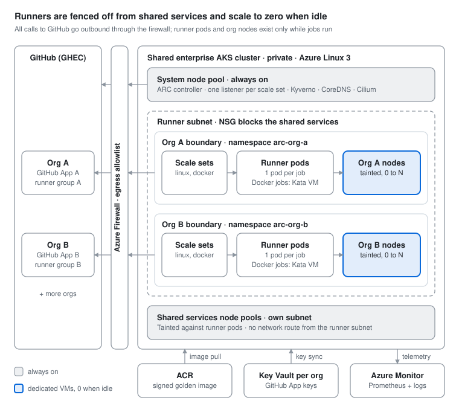

# GitHub Runners on AKS — High-Level Design

_As of Oct 13, 2026_

## Summary

Run GitHub's Actions Runner Controller (ARC 0.15) on the enterprise's shared AKS cluster, alongside the shared services. Runners are the cluster's least-trusted tenant. Each GitHub org gets its own GitHub App, namespace and tainted node pool, runner nodes sit in a subnet that can't reach the shared services, and admission policy enforces every rule. Runner pods and runner nodes scale to zero when no jobs are queued. A signed runner image is rebuilt at least weekly and runs on AKS-managed Azure Linux 3 nodes.

| Requirement | How the design meets it |
| --- | --- |
| Isolation between GitHub orgs | Per org: GitHub App, runner scale sets, namespace, secrets, network policy and node pool. Jobs from two orgs never share a node. Docker jobs also run in their own Kata pod VM. |
| Safe on a shared enterprise cluster | Runner node pools in their own subnet with no route to the shared services. Admission policy, Pod Security and default-deny network policy on every runner namespace. Security signs off the residual risk before the pilot. |
| Lowest spend when idle | `minRunners: 0` on every scale set; runner nodes are created on demand and removed when empty. The control plane and egress are already paid by the shared cluster, so the runner platform's idle cost is the ARC controller, its listeners and a share of registry, vault and logs. |
| Golden image with OS lifecycle | Two layers, two owners. AKS patches the node OS weekly in a maintenance window. The platform team hardens, builds, scans, signs and promotes the runner pod image weekly and on every runner release. |

**Assumptions to confirm**

- GitHub Enterprise Cloud, with several orgs under one enterprise.
- Linux x64 jobs only in phase 1; Windows and Arm later, if at all.
- One shared enterprise AKS cluster hosts both the runners and the shared services. A separate runner cluster is ruled out, to limit the number of clusters to operate. GitHub recommends keeping production workloads off clusters that run runners, because jobs run arbitrary code ([docs](https://docs.github.com/en/actions/how-tos/manage-runners/use-actions-runner-controller/deploy-runner-scale-sets)); [Sharing the cluster with enterprise services](#sharing-the-cluster-with-enterprise-services) covers how the design compensates.
- Some jobs build container images, so a Docker-capable tier is needed.

## Architecture at a glance

Each scale set's listener waits for jobs from the system pool. When a job is assigned, ARC creates a runner pod in that org's namespace, and NAP adds a node to that org's pool only if none has room. Shared services run on their own node pools in a separate subnet, which runner nodes can't reach.

## Runner orchestration with ARC

ARC runner scale sets (the GitHub-supported mode) run ephemeral runners: every job gets a fresh pod that is deleted when the job ends. The current release, 0.15.0 (Oct 1, 2026), adds in-place patch upgrades and controller tuning for clusters with many scale sets ([changelog](https://github.blog/changelog/2026-10-01-actions-runner-controller-release-0-15-0/)).

- **One controller, many scale sets.** The controller runs in `arc-system` on the system pool. Each org's scale sets install into that org's own namespace, as [GitHub recommends](https://docs.github.com/en/actions/how-tos/manage-runners/use-actions-runner-controller/deploy-runner-scale-sets).
- **Org-level registration.** Each scale set registers to `https://github.com/<org>` with that org's GitHub App. The App then needs only the organization permission "Self-hosted runners: read and write". Repository-level registration, used in the PoC, needs repository "Administration: read and write", which is much broader ([docs](https://docs.github.com/en/actions/how-tos/manage-runners/use-actions-runner-controller/authenticate-to-the-api)). Enterprise-level scale sets would need a classic PAT, so the design avoids them.
- **Scale sets per org:** `<org>-linux` (default), `<org>-docker` (opt-in, Kata) and `<org>-spot` (retry-tolerant jobs). Since ARC 0.14 one scale set can carry several labels, so workflows target combinations without a scale set for each ([changelog](https://github.blog/changelog/2026-03-19-actions-runner-controller-release-0-14-0/)).

| Container mode | Privileged | What jobs can do | Use it for |
| --- | --- | --- | --- |
| `kubernetes-novolume` (default) | No | Container jobs, service containers and container actions, each run as its own pod by runner container hooks; no shared RWX volume needed | Most build and test jobs |
| `kubernetes` | No | Same, with a persistent volume per runner | Only if jobs need concurrent writes to a shared workspace |
| `dind` | Yes, the Docker sidecar | Full Docker, including `docker build` | Image builds, on Kata-sandboxed nodes only |

Keep `ACTIONS_RUNNER_REQUIRE_JOB_CONTAINER` at its default in the Kubernetes modes. Turning it off runs job steps in the runner pod, which can create pods and read secrets through the API server ([docs](https://docs.github.com/en/actions/how-tos/manage-runners/use-actions-runner-controller/deploy-runner-scale-sets)). Moving image builds to ACR Tasks is an alternative that removes Docker from runners entirely.

## Isolation between orgs

Each org gets its own GitHub credentials, namespace, network boundary and VMs; Docker jobs also get their own guest kernel. GitHub's baseline is a namespace per org and a GitHub App per scale set ([docs](https://docs.github.com/en/actions/how-tos/manage-runners/use-actions-runner-controller/deploy-runner-scale-sets)); this design adds node and network separation on top.

| Layer | Control | Prevents |
| --- | --- | --- |
| GitHub | One GitHub App per org, installed on that org only. Scale sets sit in a runner group limited to selected repos; public repos can't use them. | Jobs from org A landing on org B's runners; one credential working across orgs |
| Kubernetes | Namespace per org, with namespace-scoped RBAC, ResourceQuota and LimitRange. Pod Security `restricted`; Docker scale sets get a separate `-docker` namespace. App keys are kept away from runner pods ([GitHub App credentials](#github-app-credentials)). | Reading another org's secrets; one org starving the others |
| Network | Cilium policy: default deny, no cross-namespace traffic. Job pods can't reach the API server, the instance metadata endpoint or Azure WireServer. Egress only through the firewall allowlist. | Lateral movement; stealing a node's managed identity token |
| Node | A node pool per org, tainted `gh-org=<org>:NoSchedule`. Admission policy injects the matching toleration and node selector into every pod, including the job pods the runner creates, and rejects other orgs' tolerations. | Two orgs' jobs sharing a kernel, disk or image cache |
| Sandbox | The `dind` scale set uses `runtimeClassName: kata-vm-isolation`, so each job runs in its own lightweight VM. | A privileged container escape reaching the node |

**Why node pools, not namespaces alone.** A namespace separates access through the Kubernetes API, but pods on the same node share its kernel and container runtime. After a container escape on a shared node, a job could read other orgs' job secrets and tokens, take a pending runner's registration token, and use the kubelet's credentials to read secrets of every pod on that node. A node pool per org limits that to the attacker's own org, at no extra idle cost because the pools scale to zero. Taints alone don't enforce this, since any pod can add a toleration; admission policy does.

Pick an isolation tier per org:

| Tier | Boundary | Extra cost | When |
| --- | --- | --- | --- |
| A. Namespace only, shared nodes | Shared kernel | None | Not used between orgs |
| B. Node pool per org (default) | Separate VMs per org | None when idle; slightly worse packing when busy | Every org |
| C. B plus Kata for Docker jobs | Separate guest kernel per Docker job | Per-pod overhead; each pod's CPU rounds up to whole vCPUs | Orgs that build images |
| D. B plus Kata for every job | Separate guest kernel per job | Per-pod overhead on every job | If security wants more margin on the shared cluster |

A cluster per org is out of scope: the design runs on one shared cluster.

Kata limits to plan for: Azure Linux node pools only, a Gen2 VM size with nested virtualization, no Trusted Launch or FIPS on those pools, and no Defender for Containers assessment of Kata pods ([docs](https://learn.microsoft.com/en-us/azure/aks/use-pod-sandboxing)).

**Shared trust point:** the ARC controller in `arc-system` serves every org and can read every org's GitHub App credential. Only platform admins may change anything in `arc-system`.

## Sharing the cluster with enterprise services

Runners run arbitrary code from every repo in every onboarded org, so the design treats them as the cluster's least-trusted tenant and fences them off from the shared services.

| Control | What it does |
| --- | --- |
| Node pools separated both ways | Runner pods run only on runner node pools, and shared services only on theirs. Both sets are tainted, and admission policy rejects pods that tolerate the other side's taint. |
| Runner subnet with an NSG | Runner node pools sit in their own subnet. Its NSG blocks the shared services' subnets, internal load balancers and private endpoints. The shared services' own network policies deny traffic from runner namespaces. |
| Capacity limits | Runner pods get the lowest PriorityClass, and each runner NodePool has a CPU cap, so a CI burst can't starve the shared services. ARC's listener QPS and controller concurrency settings limit load on the shared API server ([changelog](https://github.blog/changelog/2026-10-01-actions-runner-controller-release-0-15-0/)). |
| Scoped, highly available policy engine | Kyverno runs with several replicas. Runner policies select runner namespaces by label, so a policy outage or mistake blocks only runner pods, never the shared services. |

**Residual risk for security to sign off before the pilot:** the control plane, API server and policy engine serve both runners and shared services. A Kubernetes vulnerability or a policy mistake could still cross over. Tier D (Kata for every job) reduces this further if needed.

**Coupled changes:** cluster upgrades, and ARC upgrades that change CRDs (which need a reinstall), are scheduled in the shared services' change windows.

## Cost when idle

With no queued jobs, no runner pods and no runner nodes exist. The shared cluster already pays for the control plane, system pool and egress path, so the runner platform's own idle cost is small.

- **Pods:** `minRunners: 0` on every scale set, so ARC scales to zero when no jobs are assigned ([docs](https://docs.github.com/en/actions/how-tos/manage-runners/use-actions-runner-controller/deploy-runner-scale-sets)). `maxRunners` caps burst spend per scale set.
- **Nodes:** one node auto-provisioning (NAP, managed Karpenter) `NodePool` per org, consolidating empty nodes after a short `consolidateAfter` delay. `limits.cpu` on each NodePool is a hard ceiling per org ([docs](https://learn.microsoft.com/en-us/azure/aks/use-node-auto-provisioning)). Kata pools use classic node pools with cluster autoscaler minimum 0.
- **VM size:** NAP picks the VM from pending pod requests ([docs](https://learn.microsoft.com/en-us/azure/aks/node-auto-provisioning)), within an allowlist of general-purpose families. Right-sized runner requests let jobs pack well.
- **Spot:** the `<org>-spot` scale set runs on spot capacity for retry-tolerant jobs. The default stays on demand, because an eviction kills the running job.
- **Warm runners:** ARC has no scheduled min/max ([docs](https://docs.github.com/en/actions/how-tos/manage-runners/use-actions-runner-controller/deploy-runner-scale-sets)). Where cold start hurts, a CronJob raises `minRunners` in business hours only.
- **No license fee:** the runner software and ARC are open source. GitHub announced a $0.002 per minute platform charge for self-hosted runners on private repos from March 1, 2026, then postponed it with no new date ([changelog](https://github.blog/changelog/2025-12-16-coming-soon-simpler-pricing-and-a-better-experience-for-github-actions/)). Watch for it to return.

| Always-on component | Why | How to keep it small |
| --- | --- | --- |
| AKS control plane and egress | Cluster API; outbound control | Already paid by the shared cluster |
| ARC controller and listeners | One controller; one listener per scale set, on the system pool | Tight requests on listeners; fewer, multi-label scale sets |
| ACR, Key Vault, Log Analytics | Images, GitHub App keys, logs | Short retention on runner logs; purge old images |

The trade-off is cold start: the first job after idle waits for a node to boot and the image to pull. Track it with `gha_job_startup_duration_seconds` and keep the runner image slim. Showback per org comes from namespace labels in AKS cost analysis.

## Golden image and OS lifecycle

Two images, two owners: AKS patches the node OS weekly; the platform team owns the runner pod image and rebuilds it weekly and on every runner release.

### Node OS (owned by AKS)

- **OS:** Azure Linux 3 on every pool; Kata requires Azure Linux. Azure Linux 2.0 node images are removed on Oct 31, 2026, after which those pools can't scale ([docs](https://learn.microsoft.com/en-us/azure/aks/auto-upgrade-node-os-image)).
- **Channel:** node OS auto-upgrade `NodeImage`, a weekly VHD with security and bug fixes, in an `aksManagedNodeOSUpgradeSchedule` window of 4 hours or more ([docs](https://learn.microsoft.com/en-us/azure/aks/auto-upgrade-node-os-image)). Kubernetes patch versions follow the cluster auto-upgrade channel in its own `aksManagedAutoUpgradeSchedule` window.
- **SecurityPatch** ships CVE fixes faster but carries no bug fixes and conflicts with a deny-effect CMK disk policy. Revisit it if the CVE SLA demands faster patching.
- **No interrupted jobs:** on NAP pools, runner pods carry `karpenter.sh/do-not-disrupt`, so consolidation, node expiry and image drift wait for the job to finish. On classic Kata pools, set the OS window outside peak CI hours.

### Runner pod image (owned by the platform team)

1. **Base:** `ghcr.io/actions/actions-runner`, pinned by digest.
2. **Platform layer:** corporate CA certs, proxy settings, the hook extension template and a few common CLIs. Toolchains stay out; jobs bring them in their job container.
3. **Org overlay (optional):** built `FROM` the platform image, owned by the org, built by the same pipeline.

**Hardening the runner image.** The stock image gives the `runner` user passwordless sudo and makes `/home/runner` world-writable ([Dockerfile](https://github.com/actions/runner/blob/main/images/Dockerfile)). The platform layer:

- removes sudo and sets `/home/runner` to 755, owned by `runner`
- ships the Docker CLI and buildx only in the `-docker` variant used on Kata nodes
- keeps build-time packages in a build stage, so the final image carries only what runs

**Job and service images** come only from the platform ACR. ACR cache rules pull approved Docker Hub and GHCR images, and admission policy and the firewall block other registries.

The image pipeline:

1. **Trigger:** a new runner release, a base-image digest change, the weekly schedule, or a critical CVE.
2. **Build** in a platform repo, on a platform-only scale set.
3. **Scan** with Trivy or Defender; fail on critical or high findings that have a fix.
4. **Sign and push:** SBOM, signature (Notation or cosign) and an immutable tag `<runner-version>-<yyyymmdd>` in ACR; record the digest.
5. **Canary:** roll to the platform scale set and smoke-test a container job, a service container and a Kata Docker build.
6. **Promote by ring:** a PR bumps the digest in Helm values; the deployment pipeline rolls out platform → pilot org → all orgs.
7. **Enforce:** admission policy admits only signed images from the platform ACR in runner namespaces.
8. **Retire:** keep the last 3 versions for rollback; ACR purge removes older ones.

Rollback is a revert of the digest PR: new pods start on the previous image, with no node changes.

**Runner version guardrail:** since Sep 29, 2026, GitHub Enterprise Cloud blocks runners below 2.329.0 from registering, and runners below a higher execution minimum stop running jobs ([changelog](https://github.blog/changelog/2026-09-28-self-hosted-runner-version-enforcement-date-has-moved/)). Treat every runner release as a mandatory rebuild, and alert from GitHub's runner version deprecation API.

## Security guardrails

Kyverno (in enforce mode) or Azure configuration enforces every rule below, so isolation never depends on a scale set being configured correctly. Policies live in Git, violations raise alerts, and exceptions go through a PR with an expiry date.

### Namespaces

- One namespace per org, plus a `-docker` namespace for orgs with Docker jobs, created only from a template. The template adds:
  - the label `gh-org=<org>`
  - Pod Security `restricted`; `privileged` only on the `-docker` namespace, where Kyverno requires Kata
  - default-deny network policy
  - ResourceQuota (CPU, memory, ephemeral storage, pod count) and LimitRange defaults
- No human write access. The runner service account gets only what the container hooks need, in its own namespace.

### Pods

- Kyverno injects the org's node selector and toleration into every pod, including job pods created by the hooks.
- Deny:
  - other orgs' tolerations, and the shared services' tolerations
  - `spec.nodeName`, which bypasses taints entirely
  - `hostNetwork`, `hostPID`, `hostIPC`, `hostPath` and `hostPort`
  - `shareProcessNamespace`
- Job pods get `automountServiceAccountToken: false`; only the runner pod gets a token.
- CPU, memory and ephemeral-storage requests and limits are required, so one job can't fill a node's disk.
- `activeDeadlineSeconds` on runner and job pods caps job duration, which limits crypto-mining abuse.
- In `-docker` namespaces, `runtimeClassName: kata-vm-isolation` is required.

### Containers

- `runAsNonRoot`, `allowPrivilegeEscalation: false`, all capabilities dropped, seccomp `RuntimeDefault`.
- The runner container's root filesystem is read-only, with `emptyDir` volumes for `_work` and `/tmp`.
- Job containers come from workflows, not the Helm chart, so they get the same settings through the hook extension template, and Kyverno enforces them.
- Only the `dind` sidecar may be privileged, and only inside Kata.
- Many public job images (node, python) run as root, which `restricted` rejects. Publish non-root job images in ACR, or allow root only in Kata namespaces.

### Network

- Default-deny ingress and egress in every runner namespace. Runner and job pods need no inbound traffic.
- Egress is allowed only for:
  - DNS to CoreDNS
  - the API server, from runner pods only (the hooks need it)
  - everything else, through Azure Firewall
- 169.254.169.254 (instance metadata) and 168.63.129.16 (Azure WireServer) are explicitly denied, so pods can't take the node's managed identity.
- The firewall allows only GitHub Actions endpoints, the platform ACR and the internal package proxy, by FQDN. Per-org additions go through a PR.
- The runner subnet's NSG blocks the shared services ([Sharing the cluster](#sharing-the-cluster-with-enterprise-services)).

### GitHub App credentials

ARC reads an org's App credential from a Kubernetes secret in the scale set's namespace, the same namespace its runner pods run in. In `kubernetes` and `kubernetes-novolume` modes, ARC's default runner role can get and list every secret in that namespace ([chart](https://github.com/actions/actions-runner-controller/blob/gha-runner-scale-set-0.15.0/charts/gha-runner-scale-set/templates/kube_mode_role.yaml)). A compromised runner pod could therefore read its org's App private key and use it to register rogue runners or remove the org's runners. Pick one fix before production:

| Option | How | Trade-off |
| --- | --- | --- |
| Custom runner service account | Set `template.spec.serviceAccountName` to a role without get or list on secrets | A spike must confirm the container hooks still work |
| ARC's built-in Key Vault mode | `keyVault.type: azure_key_vault`. The controller and listener look the credential up in Key Vault, so no copy sits in the runner namespace. | In 0.15.0 it authenticates only with a service-principal client certificate, mounted in `arc-system`, not workload identity ([source](https://github.com/actions/actions-runner-controller/blob/gha-runner-scale-set-0.15.0/vault/azurekeyvault/config.go)) |

Also:

- One Key Vault per org, readable only by that org's identity, behind a private endpoint.
- Each App has only "Self-hosted runners: read and write" and is installed on its own org.
- Keys are rotated on a fixed schedule.

### Images and supply chain

- Runner pods run only signed images from the platform ACR, referenced by digest.
- Job and service images come only from the platform ACR ([Golden image](#golden-image-and-os-lifecycle)).
- Packages (npm, pip, Maven, NuGet) come only through an internal proxy such as Artifactory or Azure Artifacts, and the firewall blocks public registries. That stops dependency-confusion attacks and gives one place to block a bad package.
- Enterprise Actions policy allows only approved actions and requires pinning them to a commit SHA ([changelog](https://github.blog/changelog/2025-08-15-github-actions-policy-now-supports-blocking-and-sha-pinning-actions/)).
- No caches or volumes are shared across orgs.
- ACR: private endpoint, anonymous pull off, immutable tags.

### Control plane and nodes

- Private API server; Entra ID sign-in with Azure RBAC; local accounts disabled.
- No standing cluster-admin: admins get just-in-time access through PIM. Only the platform team can change webhooks, policies, CRDs and `arc-system`.
- Secrets in etcd are encrypted with a customer-managed key (KMS), and Kubernetes audit logs go to the SIEM.
- Nodes:
  - SSH disabled ([docs](https://learn.microsoft.com/en-us/azure/aks/manage-ssh-node-access))
  - ephemeral OS disks with encryption at host
  - runner nodes expire daily through the NodePool expiry setting, so anything planted on a node doesn't survive long ([docs](https://learn.microsoft.com/en-us/azure/aks/node-auto-provisioning-disruption))
  - Trusted Launch on runc runner pools (Kata pools don't support it)
  - kubelet identity limited to pulling from the platform ACR, and Image Cleaner removes stale images

### GitHub settings

- Runner groups are limited to selected repos; public repos can't use them; fork pull requests need approval before running.
- Build and deploy runners are separate scale sets.
  - Build runners have no route to internal networks.
  - Deploy runner groups are limited to approved reusable workflows ([GitHub blog](https://github.blog/2022-03-23-github-actions-secure-self-hosted-runners-specific-workflows/)), and deploy jobs use environments with required reviewers.
- Jobs reach Azure only through GitHub OIDC, with federated credentials bound to org, repo and environment. Runner pods get no Azure identity.
- The default `GITHUB_TOKEN` permissions are read-only.

### Detection and response

- Defender for Containers on runc nodes, plus Falco or Tetragon for syscall-level alerts: shells in runner pods, crypto-mining, metadata-endpoint calls and unusual egress. Defender doesn't assess Kata pods, so Kata pools rely on the VM boundary plus audit and flow logs.
- Firewall and Cilium flow logs go to the SIEM.
- Each org's runner logs are readable only by that org and the platform team, since logs can contain secrets that masking missed.
- A tested quarantine runbook: set the org's scale sets to 0, cordon its node pool, rotate its GitHub App key, then review audit and flow logs.

## Observability and operations

The platform is judged on four numbers: time for a job to start, failed runners, idle spend per org, and policy violations.

- **Metrics:** enable ARC metrics on the controller and listeners, scraped into Azure Managed Prometheus with Grafana. Key series: `gha_job_startup_duration_seconds`, `gha_assigned_jobs` against `gha_desired_runners`, and `gha_controller_failed_ephemeral_runners` ([docs](https://docs.github.com/en/actions/how-tos/manage-runners/use-actions-runner-controller/deploy-runner-scale-sets)).
- **Logs:** controller, listener and runner logs go to Log Analytics with a retention policy, as GitHub advises. NAP events come from the `karpenter-events` control plane log category ([docs](https://learn.microsoft.com/en-us/azure/aks/use-node-auto-provisioning)).

Starting alerts, to tune after a month of baseline:

| Signal | Alert when | First response |
| --- | --- | --- |
| Runtime detection | Any high-severity alert in a runner namespace | Run the quarantine runbook |
| Policy violations | Any denied admission in a runner namespace | Find the source; fix the template or the workflow |
| Job start time, p95 | Above the agreed target for 15 min | Check node provisioning and image pull |
| Failed ephemeral runners | Non-zero for 15 min | Check image, GitHub App key, quota |
| Runner version | Within 30 days of a GitHub deprecation date | Rebuild and promote the image |
| NodePool CPU | Above 80% of `limits.cpu` | Confirm the demand, then raise the cap |
| Idle spend | Floor above budget | Review listener count and requests |

Day-2 operations:

- **Onboard an org:** one PR from a template: namespaces, quota, network policy, NodePool, Key Vault reference and scale sets. The guardrail policies apply automatically through the namespace label.
- **Drain the queue:** set `minRunners` and `maxRunners` to 0 ([docs](https://docs.github.com/en/actions/how-tos/manage-runners/use-actions-runner-controller/deploy-runner-scale-sets)).
- **ARC upgrades:** patch upgrades now update in place ([0.15](https://github.blog/changelog/2026-10-01-actions-runner-controller-release-0-15-0/)). Upgrades with CRD changes need scale sets uninstalled and ARC reinstalled ([docs](https://docs.github.com/en/actions/how-tos/manage-runners/use-actions-runner-controller/deploy-runner-scale-sets)), so run them in a change window and drain the queue first.
- **Infrastructure as code:** Terraform for Azure and Kubernetes resources, with Terraform-managed Helm releases for ARC and scale sets. The PoC implementation is in `poc/terraform/`; any later GitOps migration must explicitly transfer resource ownership.

## Open decisions and rollout

These decisions shape the build; the recommendation column is the default if no other input arrives.

| Decision | Options | Recommendation |
| --- | --- | --- |
| GitHub product and org list | GHEC or GHES; which orgs | Confirm; design assumes GHEC |
| Residual risk on the shared cluster | Accept with these controls; add Kata for every job | Security signs off before the pilot |
| GitHub App key location | Custom runner role without secret read; ARC built-in Key Vault | Custom role, if a spike shows the hooks still work |
| Docker in jobs | None; `dind` on Kata; builds moved to ACR Tasks | Kata `dind` tier only for orgs that need it |
| Isolation tier per org | B, C or D | B for all, C where Docker is needed, D if security asks |
| Job images that run as root | Non-root images in ACR; root allowed only in Kata | Non-root images; root only in Kata |
| Cold-start tolerance | Accept; business-hours warm runners | Measure in the pilot, then decide per org |
| Spot capacity | Off; opt-in scale set | Opt-in scale set |
| Node scaling | NAP; classic autoscaled pools | NAP for runc pools; spike to confirm it coexists with autoscaled Kata pools, else classic pools everywhere |
| Windows or Arm runners | Now; later; never | Later; NAP doesn't support Windows pools ([docs](https://learn.microsoft.com/en-us/azure/aks/node-auto-provisioning)) |

Rollout:

1. **Foundation:** on the shared cluster, the runner subnet and NSG, runner node pools, Kyverno and its policies, ACR, Key Vault, ARC controller, platform scale set and image pipeline. Exit: guardrail tests pass, and the pipeline builds the golden image on its own runners. The tests show:
   - a pod without the org's toleration is rejected
   - a job can't reach the metadata endpoint or a shared service
   - a runner pod can't read the GitHub App credential
2. **Security sign-off:** security reviews the guardrail tests and accepts the residual risk.
3. **Pilot org:** `kubernetes-novolume` scale set, NodePool, quotas and metrics. Exit: job start time measured, and idle spend equals the floor.
4. **Docker tier:** Kata pool and `dind` scale set, plus a security review. Exit: `docker build` works in the sandbox and a container-escape test fails.
5. **Remaining orgs:** onboarded by template PR, with showback by namespace.
6. **Hardening:** signed-image enforcement on, runtime detection and alerts tuned, and the quarantine runbook tested.

## Sources

- [Actions Runner Controller release 0.15.0](https://github.blog/changelog/2026-10-01-actions-runner-controller-release-0-15-0/) (GitHub changelog, Oct 1, 2026)
- [Actions Runner Controller release 0.14.0](https://github.blog/changelog/2026-03-19-actions-runner-controller-release-0-14-0/) (GitHub changelog, Mar 19, 2026)
- [Deploying runner scale sets with Actions Runner Controller](https://docs.github.com/en/actions/how-tos/manage-runners/use-actions-runner-controller/deploy-runner-scale-sets) (GitHub Docs)
- [Authenticating ARC to the GitHub API](https://docs.github.com/en/actions/how-tos/manage-runners/use-actions-runner-controller/authenticate-to-the-api) (GitHub Docs)
- [ARC 0.15.0 runner role for Kubernetes mode](https://github.com/actions/actions-runner-controller/blob/gha-runner-scale-set-0.15.0/charts/gha-runner-scale-set/templates/kube_mode_role.yaml) (ARC source)
- [ARC 0.15.0 Azure Key Vault client](https://github.com/actions/actions-runner-controller/blob/gha-runner-scale-set-0.15.0/vault/azurekeyvault/config.go) (ARC source)
- [Actions runner image Dockerfile](https://github.com/actions/runner/blob/main/images/Dockerfile) (actions/runner)
- [Self-hosted runner version enforcement date has moved](https://github.blog/changelog/2026-09-28-self-hosted-runner-version-enforcement-date-has-moved/) (GitHub changelog, Sep 28, 2026)
- [Update to GitHub Actions pricing](https://github.blog/changelog/2025-12-16-coming-soon-simpler-pricing-and-a-better-experience-for-github-actions/) (GitHub changelog)
- [GitHub Actions policy now supports blocking and SHA pinning actions](https://github.blog/changelog/2025-08-15-github-actions-policy-now-supports-blocking-and-sha-pinning-actions/) (GitHub changelog, Aug 15, 2025)
- [Secure self-hosted runners by limiting them to specific workflows](https://github.blog/2022-03-23-github-actions-secure-self-hosted-runners-specific-workflows/) (GitHub blog, Mar 23, 2022)
- [Overview of node auto-provisioning in AKS](https://learn.microsoft.com/en-us/azure/aks/node-auto-provisioning) (Microsoft Learn)
- [Enable or disable node auto-provisioning in AKS](https://learn.microsoft.com/en-us/azure/aks/use-node-auto-provisioning) (Microsoft Learn)
- [Node auto-provisioning disruption policies](https://learn.microsoft.com/en-us/azure/aks/node-auto-provisioning-disruption) (Microsoft Learn)
- [Autoupgrade node OS images in AKS](https://learn.microsoft.com/en-us/azure/aks/auto-upgrade-node-os-image) (Microsoft Learn)
- [Pod sandboxing with AKS](https://learn.microsoft.com/en-us/azure/aks/use-pod-sandboxing) (Microsoft Learn)
- [Manage SSH for secure access to AKS nodes](https://learn.microsoft.com/en-us/azure/aks/manage-ssh-node-access) (Microsoft Learn)
