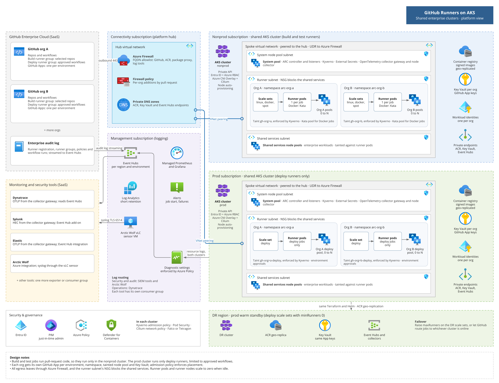
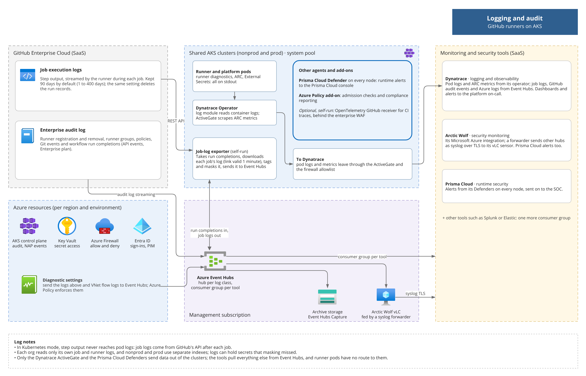

# GitHub Runners on AKS — High-Level Design

_As of Oct 19, 2026_

| | |
| --- | --- |
| Status | Draft for review |
| Version | 0.6 |
| Owner | Platform engineering (runner platform) |
| Reviewers | Security, network, shared AKS platform team, observability (Dynatrace) team, a lead from each pilot org |
| Approvers | To be named: security and the shared AKS platform owner |
| Related | PoC in [`poc/`](../poc/) and its [setup guide](poc-setup.md); diagrams in [`images/`](images/) |

## Summary

Run GitHub's Actions Runner Controller (ARC 0.15) on the enterprise's two shared AKS clusters, alongside the shared services: build and test runners in the nonprod cluster, and only tightly restricted deploy runners in the prod cluster. Runners are each cluster's least-trusted tenant. Each GitHub org gets its own GitHub App, namespace and tainted node pool, runner nodes sit in a subnet that can't reach the shared services, and admission policy enforces every rule. Runner pods and runner nodes scale to zero when no jobs are queued. AKS add-ons and managed features cover admission policy, network policy, node scaling and sandboxing. Dynatrace is the logging and observability platform, Prisma Cloud does runtime detection, and Arctic Wolf monitors security, with Azure Event Hubs carrying job logs, GitHub audit events and Azure logs to them. Prod deploy runners keep a warm standby in a DR region.

## Context and scope

Teams in several GitHub Enterprise Cloud orgs need self-hosted GitHub Actions runners inside the enterprise's Azure network, so jobs can reach private resources and deploy targets under enterprise controls. This document designs that runner platform on the enterprise's two shared AKS clusters. It keeps each org isolated, costs close to nothing when idle, and runs a golden image with a defined OS lifecycle.

**In scope:** the runner platform in the nonprod and prod clusters, which covers ARC and its scale sets, runner node pools, the golden image, security guardrails, logging, monitoring, DR and rollout.

**Out of scope:** building and running the shared clusters, hub network and enterprise tools (Dynatrace, Prisma Cloud, Arctic Wolf), which this design plugs into; the content of each org's workflows; and the PoC.

**PoC scope:** the PoC in `poc/` only proves that ARC runners work on AKS (one repository, one shared node). It doesn't implement this design's isolation or security controls; the production build follows this design.

### Assumptions to confirm

- GitHub Enterprise Cloud, with several orgs under one enterprise.
- Linux x64 jobs only in phase 1; Windows and Arm later, if at all.
- Two shared enterprise AKS clusters, nonprod and prod, host the runners alongside the shared services. Separate runner clusters are ruled out, to limit the number of clusters to operate. GitHub recommends keeping production workloads off clusters that run runners, because jobs run arbitrary code ([docs](https://docs.github.com/en/actions/how-tos/manage-runners/use-actions-runner-controller/deploy-runner-scale-sets)); [Production and non-production](#production-and-non-production) and [Sharing the cluster with enterprise services](#sharing-the-cluster-with-enterprise-services) cover how the design compensates.
- Dynatrace is the logging and observability platform, Prisma Cloud the runtime security tool and Arctic Wolf the security monitoring service. Other tools, such as Splunk or Elastic, can be added the same way.
- The shared clusters use Azure CNI Powered by Cilium for network policy and the Azure Policy add-on, and already run, or allow, the Dynatrace Operator and the Prisma Cloud Defender.
- Whether the enterprise has a DR-region cluster for the shared services is still to be confirmed; the DR options cover both cases.
- Some jobs build container images, so a Docker-capable tier is needed.

## Goals and non-goals

Each goal and how the design meets it:

| Goal | How the design meets it |
| --- | --- |
| Isolation between GitHub orgs | Per org: GitHub App, runner scale sets, namespace, secrets, network policy and node pool. Jobs from two orgs never share a node. Docker jobs also run in their own Kata pod VM. |
| Safe on shared enterprise clusters | Runner node pools in their own subnet with no route to the shared services. Admission policy, Pod Security and default-deny network policy on every runner namespace. Security signs off the residual risk before the pilot. |
| Production and non-production | Pull-request code runs only in the nonprod cluster. The prod cluster hosts only deploy runners, limited to approved workflows behind environment approvals. Platform changes reach nonprod first. |
| Lowest spend when idle | `minRunners: 0` on every scale set; runner nodes are created on demand and removed when empty. The control plane and egress are already paid by the shared clusters, so the runner platform's idle cost is the ARC controller, its listeners and a share of registry, vault and logs. |
| Golden image with OS lifecycle | Two layers, two owners. AKS patches the node OS weekly in a maintenance window. The platform team hardens, builds, scans, signs and promotes the runner pod image weekly and on every runner release. |
| Logging and audit | Runner and platform logs reach Dynatrace through the Dynatrace Operator. Job logs, GitHub audit events and Azure security logs go through a small job-log exporter and Azure Event Hubs to Dynatrace, and the security events also to Arctic Wolf. |
| Security | A threat model maps each threat to preventive controls and detections. Policy-enforced guardrails cover namespaces, pods, containers, network, credentials, images and GitHub settings, with SIEM detections and a tested quarantine runbook. |
| Monitoring | ARC and cluster metrics, dashboards and alerts in Dynatrace, with service-level targets, alerts routed to on-call and the SOC, and a synthetic canary job that proves each runner path end to end. |
| Managed over self-run | AKS add-ons and managed features cover policy, networking, scaling and sandboxing; the enterprise's Dynatrace and Prisma Cloud agents cover observability and runtime security. The platform team runs only ARC, the job-log exporter and the Key Vault secret sync. |
| Disaster recovery | Runners hold no state, so recovery is the same Terraform and Helm in another cluster. Prod deploy runners keep a warm standby; CI can fall back to GitHub-hosted runners. |

Non-goals:

- A cluster per org, or a separate runner-only cluster. The enterprise chose its two shared clusters to limit the number of clusters to operate.
- Windows or Arm runners in phase 1.
- Enterprise-level runner scale sets, which need a classic personal access token.
- Replacing the enterprise's observability and security tools.
- GitHub-hosted runners, except as a DR fallback.
- Hardening the PoC, which stays a proof that ARC works on AKS.

## Architecture at a glance

Each scale set's listener waits for jobs from the system pool. When a job is assigned, ARC creates a runner pod in that org's namespace, and NAP adds a node to that org's pool only if none has room. Shared services run on their own node pools in a separate subnet, which runner nodes can't reach. Both clusters share this layout; the prod cluster hosts only deploy scale sets.

The diagrams are drawn in draw.io with the Azure icon set: edit [`images/architecture.drawio`](images/architecture.drawio) and [`images/logging.drawio`](images/logging.drawio), then export the PNGs.

## AKS add-ons, managed features and enterprise tools

Wherever AKS offers an add-on or managed feature, the design uses it, so Microsoft patches and supports that part. For observability and runtime security, the enterprise's own tools take that place, run by their owning teams. The platform team runs only what neither covers.

| Need | What provides it | Instead of |
| --- | --- | --- |
| Admission policy | Pod Security Admission and ValidatingAdmissionPolicy, both built into Kubernetes, plus the Azure Policy add-on (Gatekeeper) ([Admission policy](#admission-policy)) | Kyverno |
| Network policy | Azure CNI Powered by Cilium | A self-installed Cilium or Calico |
| Node scaling | Node auto-provisioning (NAP); the cluster autoscaler for Kata pools | Self-managed Karpenter |
| Job sandbox | Pod Sandboxing (Kata) | Self-installed Kata or gVisor |
| Runtime detection and image scanning | Prisma Cloud Defender, the enterprise's runtime security tool ([docs](https://docs.prismacloud.io/content-collections/runtime-security/install/get-started)) | Defender for Containers, Falco or Tetragon |
| Pod logs | The Dynatrace Operator's log module ([docs](https://docs.dynatrace.com/docs/ingest-from/setup-on-k8s/deployment/k8s-log-monitoring)) | Container insights with data export, or an OpenTelemetry collector |
| Metrics, dashboards and alerts | Dynatrace, scraping ARC's Prometheus metrics through its ActiveGate ([docs](https://docs.dynatrace.com/docs/observe/infrastructure-observability/container-platform-monitoring/kubernetes-monitoring/monitor-prometheus-metrics)) | Managed Prometheus and Grafana |
| Network flow logs (optional) | Container network logs, part of Advanced Container Networking Services (paid) ([docs](https://learn.microsoft.com/en-us/azure/aks/container-network-observability-logs)) | Self-run Hubble |
| Patching, image cleanup, identity, secrets encryption, cost showback | Node OS and cluster auto-upgrade channels, Image Cleaner, workload identity, KMS etcd encryption, the cost analysis add-on | Scripts and cron jobs |

Considered but not used yet:

- **Image Integrity** checks image signatures at admission, but it is still preview and supports only the audit effect ([docs](https://learn.microsoft.com/en-us/azure/aks/image-integrity)), so it can't block an unsigned image. Until it can, admission policy allows only digest-pinned images from the platform ACR, only the image pipeline can push there, and the pipeline verifies each signature before promoting an image.
- **Defender for Containers, Container insights and Managed Prometheus** would duplicate Prisma Cloud and Dynatrace, so they stay off. Container insights with data export to Event Hubs is the fallback if the Dynatrace Operator isn't allowed on runner nodes.
- **Key Vault Secrets Provider add-on** syncs a Key Vault secret into a Kubernetes secret only while a pod in the same namespace mounts it. That would put a Key Vault identity in every runner namespace, so External Secrets Operator (as in the PoC) or ARC's built-in Key Vault mode does this job instead ([GitHub App credentials](#github-app-credentials)).

Still run by the platform team: ARC (controller and listeners), the job-log exporter and External Secrets Operator. The Dynatrace Operator, the Prisma Cloud Defender and the Arctic Wolf sensor and syslog forwarder are run by their owning teams.

## Production and non-production

Build and test jobs run pull-request code, so they stay in the nonprod cluster. The prod cluster runs only deploy jobs that need a network path to production.

| | Nonprod cluster | Prod cluster |
| --- | --- | --- |
| Scale sets per org | `<org>-linux`, `<org>-docker` and `<org>-spot` for build and test, and deploys to non-production environments | `<org>-deploy` only |
| Who can use them | Runner groups limited to selected repos | A runner group limited to approved reusable deploy workflows; jobs use GitHub environments with required reviewers |
| Network reach | Firewall allowlist only; no route to production networks | Only the production targets each org deploys to |
| GitHub App and Key Vault | A nonprod App per org; keys in the nonprod vault | A separate prod App per org; keys only in the prod vault |
| Platform changes | Land here first: ARC, runner image, policies | Promoted after a soak in nonprod |

**One App can reach every runner group in its org.** The organization permission "Self-hosted runners: read and write" lets a GitHub App register runners in any of the org's runner groups, including the deploy group. A key stolen from the nonprod cluster could register a rogue runner that picks up production deploy jobs and their OIDC tokens. Separate Apps per environment limit what a rotation or revocation touches but don't close this gap, so detection does: the SIEM alerts on any runner registered in a deploy group by anything other than the prod deploy scale sets or their DR standby, using GitHub's audit log.

## Runner orchestration with ARC

ARC runner scale sets (the GitHub-supported mode) run ephemeral runners: every job gets a fresh pod that is deleted when the job ends. The current release, 0.15.0 (Oct 1, 2026), adds in-place patch upgrades and controller tuning for clusters with many scale sets ([changelog](https://github.blog/changelog/2026-10-01-actions-runner-controller-release-0-15-0/)).

- **One controller, many scale sets.** The controller runs in `arc-system` on the system pool. Each org's scale sets install into that org's own namespace, as [GitHub recommends](https://docs.github.com/en/actions/how-tos/manage-runners/use-actions-runner-controller/deploy-runner-scale-sets).
- **Org-level registration.** Each scale set registers to `https://github.com/<org>` with that org's GitHub App. The App then needs only the organization permission "Self-hosted runners: read and write". Repository-level registration, used in the PoC, needs repository "Administration: read and write", which is much broader ([docs](https://docs.github.com/en/actions/how-tos/manage-runners/use-actions-runner-controller/authenticate-to-the-api)). Enterprise-level scale sets would need a classic PAT, so the design avoids them.
- **Scale sets per org:** `<org>-linux` (default), `<org>-docker` (opt-in, Kata) and `<org>-spot` (retry-tolerant jobs). Since ARC 0.14 one scale set can carry several labels, so workflows target combinations without a scale set for each ([changelog](https://github.blog/changelog/2026-03-19-actions-runner-controller-release-0-14-0/)).

| Container mode | Privileged | What jobs can do | Use it for |
| --- | --- | --- | --- |
| `kubernetes-novolume` (default) | No | Container jobs, service containers and container actions, each run as its own pod by runner container hooks; no shared RWX volume needed | Most build and test jobs |
| `kubernetes` | No | Same, with a persistent volume per runner | Only if jobs need concurrent writes to a shared workspace |
| `dind` | Yes, the Docker sidecar | Full Docker, including `docker build` | Image builds, on Kata-sandboxed nodes only |

Keep `ACTIONS_RUNNER_REQUIRE_JOB_CONTAINER` at its default in the Kubernetes modes. Turning it off runs job steps in the runner pod, which can create pods and read secrets through the API server ([docs](https://docs.github.com/en/actions/how-tos/manage-runners/use-actions-runner-controller/deploy-runner-scale-sets)). Moving image builds to ACR Tasks is an alternative that removes Docker from runners entirely.

## Isolation between orgs

Each org gets its own GitHub credentials, namespace, network boundary and VMs; Docker jobs also get their own guest kernel. GitHub's baseline is a namespace per org and a GitHub App per scale set ([docs](https://docs.github.com/en/actions/how-tos/manage-runners/use-actions-runner-controller/deploy-runner-scale-sets)); this design adds node and network separation on top.

| Layer | Control | Prevents |
| --- | --- | --- |
| GitHub | One GitHub App per org, installed on that org only. Scale sets sit in a runner group limited to selected repos; public repos can't use them. | Jobs from org A landing on org B's runners; one credential working across orgs |
| Kubernetes | Namespace per org, with namespace-scoped RBAC, ResourceQuota and LimitRange. Pod Security `restricted`; Docker scale sets get a separate `-docker` namespace. App keys are kept away from runner pods ([GitHub App credentials](#github-app-credentials)). | Reading another org's secrets; one org starving the others |
| Network | Kubernetes network policy, enforced by Azure CNI Powered by Cilium: default deny, no cross-namespace traffic. Job pods can't reach the API server, the instance metadata endpoint or Azure WireServer. Egress only through the firewall allowlist. | Lateral movement; stealing a node's managed identity token |
| Node | A node pool per org, tainted `gh-org=<org>:NoSchedule`. The ARC Helm values and the hook template set the matching toleration and node selector on every pod, including the job pods the runner creates. Admission policy rejects pods without them, or with another org's toleration. | Two orgs' jobs sharing a kernel, disk or image cache |
| Sandbox | The `dind` scale set uses `runtimeClassName: kata-vm-isolation`, so each job runs in its own lightweight VM. | A privileged container escape reaching the node |

**Why node pools, not namespaces alone.** A namespace separates access through the Kubernetes API, but pods on the same node share its kernel and container runtime. After a container escape on a shared node, a job could read other orgs' job secrets and tokens, take a pending runner's registration token, and use the kubelet's credentials to read secrets of every pod on that node. A node pool per org limits that to the attacker's own org, at no extra idle cost because the pools scale to zero. Taints alone don't enforce this, since any pod can add a toleration; admission policy does.

Pick an isolation tier per org:

| Tier | Boundary | Extra cost | When |
| --- | --- | --- | --- |
| A. Namespace only, shared nodes | Shared kernel | None | Not used between orgs |
| B. Node pool per org (default) | Separate VMs per org | None when idle; slightly worse packing when busy | Every org |
| C. B plus Kata for Docker jobs | Separate guest kernel per Docker job | Per-pod overhead; each pod's CPU rounds up to whole vCPUs | Orgs that build images |
| D. B plus Kata for every job | Separate guest kernel per job | Per-pod overhead on every job | If security wants more margin on the shared cluster |

A cluster per org is out of scope: the design runs on the shared nonprod and prod clusters.

Kata limits to plan for: Azure Linux node pools only, a Gen2 VM size with nested virtualization, no Trusted Launch or FIPS on those pools, and host-level security agents can't see inside Kata pods ([docs](https://learn.microsoft.com/en-us/azure/aks/use-pod-sandboxing)).

**Shared trust point:** the ARC controller in `arc-system` serves every org and can read every org's GitHub App credential. Only platform admins may change anything in `arc-system`.

## Sharing the cluster with enterprise services

Runners run arbitrary code from every repo in every onboarded org, so the design treats them as the cluster's least-trusted tenant and fences them off from the shared services.

| Control | What it does |
| --- | --- |
| Node pools separated both ways | Runner pods run only on runner node pools, and shared services only on theirs. Both sets are tainted, and admission policy rejects pods that tolerate the other side's taint. |
| Runner subnet with an NSG | Runner node pools sit in their own subnet. Its NSG blocks the shared services' subnets, internal load balancers and private endpoints. The shared services' own network policies deny traffic from runner namespaces. |
| Capacity limits | Runner pods get the lowest PriorityClass, and each runner NodePool has a CPU cap, so a CI burst can't starve the shared services. ARC's listener QPS and controller concurrency settings limit load on the shared API server ([changelog](https://github.blog/changelog/2026-10-01-actions-runner-controller-release-0-15-0/)). |
| Fail-closed, scoped policy | The placement rules run inside the API server as ValidatingAdmissionPolicy, so there is no policy webhook that could fail open. Their bindings select runner namespaces by label, so a policy mistake blocks only runner pods, never the shared services. |

**Residual risk for security to sign off before the pilot:** the control plane, API server and policy engine serve both runners and shared services. A Kubernetes vulnerability or a policy mistake could still cross over. Tier D (Kata for every job) reduces this further if needed.

**Coupled changes:** cluster upgrades, and ARC upgrades that change CRDs (which need a reinstall), are scheduled in the shared services' change windows.

## Node storage

Runners need no attached data disks or persistent volumes. Everything a job writes is scratch space that disappears with its pod, and the node's ephemeral OS disk holds it.

| What | Where it lives | Size it by |
| --- | --- | --- |
| Checkout and build output (`_work`), `/tmp` | `emptyDir` on the node's OS disk | Ephemeral-storage requests and limits per scale set |
| Docker layers in `dind` (`/var/lib/docker`) | `emptyDir` inside the Kata pod VM | The largest image the org builds |
| Runner and job images | The node's image cache, trimmed by Image Cleaner | Runner image plus the common job images |

- **Ephemeral OS disks:** NAP uses one automatically when the VM size's cache or temp disk can hold the OS disk. A NodePool requirement on `karpenter.azure.com/sku-storage-ephemeralos-maxsize` limits NAP to sizes that can, so it never falls back to a managed disk. Raise the AKSNodeClass `osDiskSizeGB` above its 128 GB default for orgs with large builds ([docs](https://learn.microsoft.com/en-us/azure/aks/node-auto-provisioning-aksnodeclass)). Ephemeral disks are faster, cost nothing extra, and are wiped with the node, along with anything a job left behind.
- **I/O-heavy builds:** allow VM families with large local temp disks in that org's NodePool only.
- **Limits:** every runner and job pod sets ephemeral-storage requests and limits ([Pods](#pods)), so a job that fills its scratch space is evicted instead of filling the node.
- **Caches stay off the nodes:** dependencies come through the internal package proxy or `actions/cache`, and images from ACR. No `hostPath` or volume is shared between jobs, which would also break isolation.
- **Persistent volumes:** only the `kubernetes` container mode needs one, a managed disk per runner created and deleted with the pod. The default `kubernetes-novolume` mode avoids it.
- **Kata:** disk I/O inside a Kata pod is slower than with runc ([docs](https://learn.microsoft.com/en-us/azure/aks/use-pod-sandboxing)), so measure Docker build times in the Docker-tier pilot.

## Golden image and OS lifecycle

Two images, two owners: AKS patches the node OS weekly; the platform team owns the runner pod image and rebuilds it weekly and on every runner release.

### Node OS (owned by AKS)

- **OS:** Azure Linux 3 on every pool; Kata requires Azure Linux. Azure Linux 2.0 node images are removed on Oct 31, 2026, after which those pools can't scale ([docs](https://learn.microsoft.com/en-us/azure/aks/auto-upgrade-node-os-image)).
- **Channel:** node OS auto-upgrade `NodeImage`, a weekly VHD with security and bug fixes, in an `aksManagedNodeOSUpgradeSchedule` window of 4 hours or more ([docs](https://learn.microsoft.com/en-us/azure/aks/auto-upgrade-node-os-image)). Kubernetes patch versions follow the cluster auto-upgrade channel in its own `aksManagedAutoUpgradeSchedule` window.
- **SecurityPatch** ships CVE fixes faster but carries no bug fixes and conflicts with a deny-effect CMK disk policy. Revisit it if the CVE SLA demands faster patching.
- **No interrupted jobs:** on NAP pools, runner pods carry `karpenter.sh/do-not-disrupt`, so consolidation, node expiry and image drift wait for the job to finish. On classic Kata pools, set the OS window outside peak CI hours.

### Runner pod image (owned by the platform team)

1. **Base:** `ghcr.io/actions/actions-runner`, pinned by digest.
2. **Platform layer:** corporate CA certs, proxy settings, the hook extension template and a few common CLIs. Toolchains stay out; jobs bring them in their job container.
3. **Org overlay (optional):** built `FROM` the platform image, owned by the org, built by the same pipeline.

**Hardening the runner image.** The stock image gives the `runner` user passwordless sudo and makes `/home/runner` world-writable ([Dockerfile](https://github.com/actions/runner/blob/main/images/Dockerfile)). The platform layer:

- removes sudo and sets `/home/runner` to 755, owned by `runner`
- ships the Docker CLI and buildx only in the `-docker` variant used on Kata nodes
- keeps build-time packages in a build stage, so the final image carries only what runs

**Job and service images** come only from the platform ACR. ACR cache rules pull approved Docker Hub and GHCR images, and admission policy and the firewall block other registries.

The image pipeline:

1. **Trigger:** a new runner release, a base-image digest change, the weekly schedule, or a critical CVE.
2. **Build** in a platform repo, on a platform-only scale set.
3. **Scan** with Prisma Cloud (`twistcli`) or Trivy; fail on critical or high findings that have a fix.
4. **Sign and push:** SBOM, signature (Notation or cosign) and an immutable tag `<runner-version>-<yyyymmdd>` in ACR; record the digest.
5. **Canary:** roll to the platform scale set and smoke-test a container job, a service container and a Kata Docker build.
6. **Promote by ring:** a PR bumps the digest in Helm values; the deployment pipeline rolls out platform → pilot org → all orgs.
7. **Enforce:** admission policy admits only digest-pinned images from the platform ACR in runner namespaces, and only the pipeline can push there.
8. **Retire:** keep the last 3 versions for rollback; ACR purge removes older ones.

Rollback is a revert of the digest PR: new pods start on the previous image, with no node changes.

**Runner version guardrail:** since Sep 29, 2026, GitHub Enterprise Cloud blocks runners below 2.329.0 from registering, and runners below a higher execution minimum stop running jobs ([changelog](https://github.blog/changelog/2026-09-28-self-hosted-runner-version-enforcement-date-has-moved/)). Treat every runner release as a mandatory rebuild, and alert from GitHub's runner version deprecation API.

## Security design

Runners run untrusted code from every onboarded repo, so security is layered: each threat below meets at least one preventive control and one detection. Admission policy or Azure configuration enforces every guardrail, so isolation never depends on a scale set being configured correctly. Policies live in Git, violations raise alerts, and exceptions go through a PR with an expiry date.

### Threat model

| Threat | Main controls | Detection |
| --- | --- | --- |
| Malicious code in a workflow, dependency or action | Ephemeral pods and nodes; restricted, non-root pods; no Azure identity on runners; egress allowlist; approved actions pinned by SHA; fork pull requests need approval | Runtime detection, firewall logs |
| Container escape to the node | Node pool per org; Kata for Docker jobs; seccomp; no host access; daily node expiry | Prisma Cloud runtime alerts |
| One org reaching another org's jobs, secrets or nodes | Per org: GitHub App, namespace, network policy, node pool and Key Vault | Admission denials, flow logs |
| Theft of a GitHub App key | Key kept out of runner namespaces; separate Apps per org and environment; scheduled rotation | Unexpected runner registrations in the GitHub audit log; Key Vault reads |
| Rogue runner picking up prod deploy jobs | Deploy groups limited to approved workflows; environment reviewers | Any runner registered in a deploy group outside the prod or DR scale sets |
| Lateral movement into shared services | Runner subnet NSG; node pools tainted both ways; default-deny network policy | VNet flow logs; container network logs if enabled |
| Stealing the node's managed identity | Metadata endpoint and WireServer blocked; kubelet identity limited to ACR pulls | Flow logs, runtime detection |
| Data exfiltration | Firewall FQDN allowlist; package proxy; no route to internal networks from build runners | Firewall denials; upload volume per runner |
| Poisoned runner, job or package image | Images only from the platform ACR, pinned by digest and signed by the pipeline; scanning; package proxy | Vulnerability findings, admission denials |
| Resource abuse: crypto-mining, or a burst starving shared services | Quotas, NodePool CPU caps, lowest PriorityClass, `activeDeadlineSeconds` | Runtime detection, NodePool CPU alert |
| Secrets leaking into logs | GitHub masking, exporter masking, per-org log access | SIEM rules for credential patterns in job logs |
| Admin misuse or a bad change | Just-in-time admin through PIM; changes by PR; policy tests in CI | Kubernetes audit log, Entra ID logs |
| Tampering with deploy workflows | Approved reusable workflows; CODEOWNERS and rulesets on workflow files; protected branches | GitHub audit log |

### Guardrails by level

What to set at each level, where it's set, and what enforces it. "Admission policy" means the three layers in [Admission policy](#admission-policy): Pod Security Admission (PSA), ValidatingAdmissionPolicy (VAP) and the Azure Policy add-on.

| Level | Guardrail | Set in | Enforced by |
| --- | --- | --- | --- |
| GitHub | Runner groups limited to selected repos; public repos blocked; fork pull requests need approval | Org settings | GitHub |
| GitHub | Deploy runner groups limited to approved reusable workflows; environments with required reviewers | Org and repo settings | GitHub; SIEM alert on any runner in a deploy group outside the prod or DR scale sets |
| GitHub | Only approved actions, pinned to a commit SHA; `GITHUB_TOKEN` read-only by default | Enterprise Actions policy | GitHub |
| GitHub | CODEOWNERS and rulesets on `.github/workflows`; deploys only from protected branches | Rulesets | GitHub |
| GitHub | One App per org per environment, with only "Self-hosted runners: read and write" | App registration | GitHub; audit-log alerts |
| Azure | Private API server, Entra ID with Azure RBAC, local accounts off, admin only through PIM | Terraform | Azure Policy |
| Azure | Runner subnet NSG blocks the shared services; all egress through the Azure Firewall FQDN allowlist | Terraform, firewall policy | NSG, Azure Firewall |
| Azure | Private endpoints for ACR, Key Vault and Event Hubs; diagnostic settings on every resource | Terraform | Azure Policy |
| Azure | A Key Vault per org, with soft delete, purge protection and Azure RBAC | Terraform | Azure Policy |
| Cluster | Private API server; Entra ID and Azure RBAC; no standing admin; RBAC without wildcards or escalation; KMS encryption for secrets; auto-upgrade | Terraform, PIM | Azure Policy, AKS, Kubernetes RBAC |
| Node pool | A pool per org, tainted `gh-org=<org>`, with a CPU cap and daily node expiry; Kata pools for Docker jobs; only approved agents tolerate runner taints | Terraform (NAP NodePools) | NAP; admission policy keeps other pods off |
| Node pool | Azure Linux 3, Trusted Launch on runc pools, ephemeral OS disks with encryption at host, SSH off, no public IPs | Terraform | Azure Policy, AKS |
| Namespace | One per org, plus `-docker`, labelled `gh-org=<org>`; no Azure Policy ignore label | Terraform template | VAP |
| Namespace | Pod Security `restricted`; `privileged` only in `-docker` namespaces | Namespace label | PSA |
| Namespace | Default-deny network policy; ResourceQuota and LimitRange | Terraform template | Azure CNI Powered by Cilium; Kubernetes |
| Namespace | Runner service account with only what the hooks need, no secret read; no human write access | Terraform, Helm | Kubernetes RBAC |
| Pod | The org's node selector and toleration, never another org's; no `spec.nodeName` | Helm values, hook template | VAP |
| Pod | No `hostNetwork`, `hostPID`, `hostIPC`, `hostPath` or `hostPort` | Helm values, hook template | PSA |
| Pod | No service account token on job pods; CPU, memory and ephemeral-storage limits; `activeDeadlineSeconds` | Helm values, hook template | VAP |
| Pod | `runtimeClassName: kata-vm-isolation` in `-docker` namespaces | Helm values | VAP |
| Container | Non-root, no privilege escalation, all capabilities dropped, seccomp `RuntimeDefault` | Helm values, hook template | PSA |
| Container | Read-only root filesystem on the runner, with `emptyDir` for `_work` and `/tmp` | Helm values | Helm values |
| Container | Privileged only for the `dind` sidecar, inside Kata | Helm values | PSA and VAP |
| Image | Only from the platform ACR, pinned by digest | Helm values, workflows | VAP; Azure Policy allowed-images policy |
| Image | Hardened (no sudo), scanned, signed, rebuilt weekly | Image pipeline | Pipeline gates; Prisma Cloud scanning |
| Image | Packages only through the internal proxy | Firewall policy | Azure Firewall |
| Network | Metadata endpoint and WireServer blocked; API server reachable from runner pods only | Network policy | Azure CNI Powered by Cilium |
| Network | No inbound Services or Ingress; egress and DNS only through Azure Firewall | Terraform, firewall policy | VAP; Azure Firewall |
| Credentials | GitHub App keys out of runners' reach; jobs reach Azure only through GitHub OIDC; runner pods get no Azure identity | Helm, Entra federated credentials | Kubernetes RBAC, Entra ID |
| Identity | Just-in-time admin through PIM, a sealed break-glass account, workload identity only for platform components, quarterly access reviews | Entra ID, Terraform | PIM, Entra ID |
| Audit | GitHub, Kubernetes, Azure, Entra ID, Key Vault and network audit logs to the SOC and the archive | Diagnostic settings, audit log streaming | Azure Policy keeps them on; Activity log alerts on changes |
| Detection | Runtime rules for shells, miners, metadata calls and odd egress; SIEM detections; quarantine runbook | Prisma Cloud, Arctic Wolf | Prisma Cloud, the SOC |

### Admission policy

Three layers check every pod in a runner namespace. The first two are built into the Kubernetes API server, so they need no add-on and fail closed.

| Layer | What it enforces | Why this layer |
| --- | --- | --- |
| Pod Security Admission at the `restricted` level, set by namespace label | Non-root, no privilege escalation, all capabilities dropped, seccomp, no host namespaces or host paths | Built in; no policy code to write |
| ValidatingAdmissionPolicy (CEL), managed by Terraform ([docs](https://kubernetes.io/docs/reference/access-authn-authz/validating-admission-policy/)) | The org's own node selector and toleration on every pod, and no other org's; no `spec.nodeName`; images only from the platform ACR, pinned by digest; the Kata runtime class in `-docker` namespaces; resource limits and `activeDeadlineSeconds`; no Azure Policy ignore label on runner namespaces | Runs inside the API server and fails closed. It reads the namespace's `gh-org` label, so one policy covers every org. |
| Azure Policy add-on (Gatekeeper) ([docs](https://learn.microsoft.com/en-us/azure/governance/policy/concepts/policy-for-kubernetes)) | The enterprise's Kubernetes baseline initiative and the built-in allowed-images policy, in deny mode | Managed by AKS, and reports compliance to Azure Policy for audit |

What to plan for:

- **The policies don't change pods.** The ARC Helm values and the container hook template set the node selector, toleration and security context; admission policy only rejects. A wrong template shows up as a failed job, not a pod quietly placed on the wrong nodes.
- **Gatekeeper can fail open.** Upstream Gatekeeper's webhooks default to `failurePolicy: Ignore`, which admits pods while the webhook is down ([chart defaults](https://images.chainguard.dev/directory/community-chart/gatekeeper/defaultValues)). Check the add-on's setting in the pilot. Isolation doesn't depend on it, because the first two layers fail closed.
- **Azure Policy changes take up to 15 minutes.** The add-on checks for assignment changes and rescans the cluster every 15 minutes. Onboarding an org needs no new assignment, because the placement policy reads the namespace label.
- **Custom Rego can't read namespace labels.** Custom Azure Policy definitions can't use Gatekeeper's data sync, which is why the placement rules are ValidatingAdmissionPolicy. Azure Policy also accepts custom CEL policies, so the rules can move into Azure Policy later if the enterprise wants every rule there.
- **The ignore label.** The add-on doesn't deny in a namespace that carries its ignore label. Only Terraform can label runner namespaces, and the ValidatingAdmissionPolicy rejects that label on them.
- **Azure resources too.** Azure Policy also enforces the Azure side: private endpoints, no public IPs on runner nodes, diagnostic settings, customer-managed keys and allowed VM sizes.
- **Policy lifecycle.** Policies live in Git and change by PR, with tests in CI ([Vulnerability management and testing](#vulnerability-management-and-testing)). A new rule starts in audit or warn mode (Azure Policy's audit effect, or `validationActions: [Warn, Audit]` on a ValidatingAdmissionPolicy) and moves to deny after a week with no unexpected hits. The platform team writes policies and security approves them. Exceptions go through a PR with an expiry date.

### Namespaces

- One namespace per org, plus a `-docker` namespace for orgs with Docker jobs, created only from a template. The template adds:
  - the label `gh-org=<org>`
  - Pod Security `restricted`; `privileged` only on the `-docker` namespace, where admission policy requires Kata
  - default-deny network policy
  - ResourceQuota (CPU, memory, ephemeral storage, pod count) and LimitRange defaults
- No human write access. The runner service account gets only what the container hooks need, in its own namespace.

### Pods

- The Helm values and the hook template set the org's node selector and toleration on every pod, including job pods created by the hooks. Admission policy rejects any pod without them.
- Deny:
  - other orgs' tolerations, and the shared services' tolerations
  - `spec.nodeName`, which bypasses taints entirely
  - `hostNetwork`, `hostPID`, `hostIPC`, `hostPath` and `hostPort`
  - `shareProcessNamespace`
- Job pods get `automountServiceAccountToken: false`; only the runner pod gets a token.
- CPU, memory and ephemeral-storage requests and limits are required, so one job can't fill a node's disk.
- `activeDeadlineSeconds` on runner and job pods caps job duration, which limits crypto-mining abuse.
- In `-docker` namespaces, `runtimeClassName: kata-vm-isolation` is required.

### Containers

- `runAsNonRoot`, `allowPrivilegeEscalation: false`, all capabilities dropped, seccomp `RuntimeDefault`.
- The runner container's root filesystem is read-only, with `emptyDir` volumes for `_work` and `/tmp`.
- Job containers come from workflows, not the Helm chart, so they get the same settings through the hook extension template, and admission policy enforces them.
- Only the `dind` sidecar may be privileged, and only inside Kata.
- Many public job images (node, python) run as root, which `restricted` rejects. Publish non-root job images in ACR, or allow root only in Kata namespaces.

### Node pools

- **One pool per org per environment:** a NAP NodePool, or a classic pool with autoscaler minimum 0 for Kata. Each is tainted `gh-org=<org>:NoSchedule` and labelled `gh-org=<org>`. The system pool is tainted `CriticalAddonsOnly` and the shared-services pools carry their own taint, so runner pods can't land on either.
- **Only approved agents tolerate runner taints:** the Dynatrace log module, the Prisma Cloud Defender and AKS's own DaemonSets. Admission policy rejects any other pod outside runner namespaces that tolerates a `gh-org` taint.
- **Size limits:** `limits.cpu` per NodePool caps each org, NodePool requirements list the allowed VM families, and spot capacity is used only in `<org>-spot` pools.
- **OS:** Azure Linux 3, patched weekly through the node OS upgrade channel; Trusted Launch (secure boot and vTPM) on runc pools. Kata pools need Gen2 VM sizes with nested virtualization and don't support Trusted Launch.
- **Disks:** ephemeral OS disks with encryption at host, and no data disks ([Node storage](#node-storage)).
- **Access:** SSH disabled ([docs](https://learn.microsoft.com/en-us/azure/aks/manage-ssh-node-access)), no public IPs on nodes, and the runner subnet's NSG. The kubelet identity can only pull from the platform ACR.
- **Lifecycle:** runner nodes expire daily, so anything planted on a node doesn't survive long ([docs](https://learn.microsoft.com/en-us/azure/aks/node-auto-provisioning-disruption)). Empty nodes are consolidated quickly, running jobs carry `karpenter.sh/do-not-disrupt`, and Image Cleaner removes stale images.

### Kubernetes cluster

- **API server:** private, with Entra ID sign-in and Azure RBAC; local accounts disabled. The Kubernetes version stays in support through the cluster auto-upgrade channel.
- **Admin access:** no standing cluster-admin. Admins get just-in-time access through PIM, and a sealed break-glass account alerts the SOC when used ([Identity and access](#identity-and-access)).
- **Protected components:** only the platform team can change admission webhooks, ValidatingAdmissionPolicies, CRDs and `arc-system`, where ARC's controller, listeners and App credentials live.
- **RBAC hygiene:** no wildcard roles. Only cluster admins have `escalate`, `bind` and `impersonate`. Runner service accounts act only in their own namespace, `pods/exec` in runner namespaces is limited to the runner service account and just-in-time admins, and default service accounts don't mount tokens.
- **Secrets:** encrypted in etcd with a customer-managed key (KMS). Workload identity is used only by platform components (the job-log exporter and External Secrets), never by runner pods.
- **Audit:** Kubernetes audit logs go to the SIEM ([Audit](#audit)).

### Network

- Default-deny ingress and egress in every runner namespace. Runner and job pods need no inbound traffic.
- Egress is allowed only for:
  - DNS to CoreDNS
  - the API server, from runner pods only (the hooks need it)
  - everything else, through Azure Firewall
- 169.254.169.254 (instance metadata) and 168.63.129.16 (Azure WireServer) are explicitly denied, so pods can't take the node's managed identity.
- The firewall allows only GitHub Actions endpoints, the platform ACR and the internal package proxy, by FQDN. Per-org additions go through a PR.
- GitHub's required endpoints include `results-receiver.actions.githubusercontent.com` and `*.blob.core.windows.net`, which carries job logs, artifacts and caches ([docs](https://docs.github.com/en/enterprise-cloud@latest/actions/concepts/runners/communicating-with-self-hosted-runners)). That wildcard lets a job upload data to any Azure storage account. In the pilot, try narrowing it to the storage accounts the firewall logs show; GitHub can change them, so if that proves fragile, keep the wildcard and alert on unusual upload volume per runner.
- The runner subnet's NSG blocks the shared services ([Sharing the cluster](#sharing-the-cluster-with-enterprise-services)).
- No inbound paths: admission policy rejects Services of type LoadBalancer or NodePort and Ingress objects in runner namespaces.
- Outbound goes through a user-defined route to Azure Firewall, and nodes have no public IPs.
- DNS: pods resolve only through CoreDNS, which forwards to the firewall's DNS proxy, so the FQDN rules and DNS logs see every lookup and DNS tunnelling is easier to spot ([docs](https://learn.microsoft.com/en-us/azure/firewall/dns-settings)).
- ACR, Key Vault and Event Hubs are reached only through private endpoints and private DNS zones.
- If the hub firewall is Azure Firewall Premium, turn on intrusion detection and prevention (IDPS) for runner egress.

### Identity and access

| Who | Access | How |
| --- | --- | --- |
| Platform engineers | Read on the clusters; admin only when needed | Entra ID groups, Azure RBAC, PIM with approval and a time limit |
| Org owners and developers | No cluster access; they manage workflows and which repos use their runner groups | GitHub org roles |
| Security and the SOC | Read access to audit logs, Prisma Cloud and Dynatrace | Each tool's roles |
| Break-glass | Emergency cluster admin | A sealed account, with an alert on every use |
| ARC controller | Each org's GitHub App credential | Kubernetes secret in `arc-system` or ARC's Key Vault mode |
| External Secrets | Read on each org's Key Vault | Workload identity, one per org |
| Job-log exporter | Read-only GitHub App per org; send to Event Hubs | Workload identity |
| Runner and job pods | Nothing in Azure; Azure access only through GitHub OIDC per job | No workload identity |

Access is reviewed every quarter: PIM eligibility, GitHub App installations and permissions, runner group repo lists, and Key Vault access.

### GitHub App credentials

ARC reads an org's App credential from a Kubernetes secret in the scale set's namespace, the same namespace its runner pods run in. In `kubernetes` and `kubernetes-novolume` modes, ARC's default runner role can get and list every secret in that namespace ([chart](https://github.com/actions/actions-runner-controller/blob/gha-runner-scale-set-0.15.0/charts/gha-runner-scale-set/templates/kube_mode_role.yaml)). A compromised runner pod could therefore read its org's App private key and use it to register rogue runners or remove the org's runners. Pick one fix before production:

| Option | How | Trade-off |
| --- | --- | --- |
| Custom runner service account | Set `template.spec.serviceAccountName` to a role without get or list on secrets | A spike must confirm the container hooks still work |
| ARC's built-in Key Vault mode | `keyVault.type: azure_key_vault`. The controller and listener look the credential up in Key Vault, so no copy sits in the runner namespace. | In 0.15.0 it authenticates only with a service-principal client certificate, mounted in `arc-system`, not workload identity ([source](https://github.com/actions/actions-runner-controller/blob/gha-runner-scale-set-0.15.0/vault/azurekeyvault/config.go)) |

Also:

- One Key Vault per org, readable only by that org's identity, behind a private endpoint.
- Each App has only "Self-hosted runners: read and write" and is installed on its own org.
- Each org has separate nonprod and prod Apps, with keys only in that environment's vault ([Production and non-production](#production-and-non-production)).
- Keys are rotated on a fixed schedule.

### GitHub settings

- Runner groups are limited to selected repos; public repos can't use them; fork pull requests need approval before running.
- Build and deploy runners are separate scale sets.
  - Build runners have no route to internal networks.
  - Deploy runner groups are limited to approved reusable workflows ([GitHub blog](https://github.blog/2022-03-23-github-actions-secure-self-hosted-runners-specific-workflows/)), and deploy jobs use environments with required reviewers.
- Jobs reach Azure only through GitHub OIDC, with federated credentials bound to org, repo and environment. Runner pods get no Azure identity.
- For prod deploys, the OIDC subject claim also includes `job_workflow_ref`, so only the approved reusable deploy workflow can get the prod Azure token ([docs](https://docs.github.com/en/actions/reference/security/oidc)).
- Deploy secrets live only in GitHub environments with required reviewers, never as org-wide secrets.
- The default `GITHUB_TOKEN` permissions are read-only.
- Workflow files are protected by CODEOWNERS on `.github/workflows` and rulesets that require review, so a deploy workflow can't change unreviewed. Deploys run only from protected branches.
- `pull_request_target` workflows never check out and run pull-request code on self-hosted runners.

### Images and supply chain

- Runner and job pods run only images from the platform ACR, referenced by digest. The pipeline signs each image and verifies the signature before promotion; signature checks at admission wait for AKS Image Integrity to support deny.
- Job and service images come only from the platform ACR ([Golden image](#golden-image-and-os-lifecycle)).
- Packages (npm, pip, Maven, NuGet) come only through an internal proxy such as Artifactory or Azure Artifacts, and the firewall blocks public registries. That stops dependency-confusion attacks and gives one place to block a bad package.
- Enterprise Actions policy allows only approved actions and requires pinning them to a commit SHA ([changelog](https://github.blog/changelog/2025-08-15-github-actions-policy-now-supports-blocking-and-sha-pinning-actions/)).
- No caches or volumes are shared across orgs.
- ACR: private endpoint, anonymous pull off, immutable tags.
- Images that jobs build get build provenance attestations, which the deploy pipeline verifies before it deploys them.

### Data protection

- **In transit:** TLS to GitHub, ACR, Key Vault and Event Hubs; Azure services only through private endpoints; syslog to Arctic Wolf over TLS.
- **At rest:** Kubernetes secrets encrypted with a customer-managed key (KMS); encryption at host on every node, which covers the ephemeral OS and temp disks; ACR, Key Vault, Event Hubs and the log archive encrypted by Azure, with customer-managed keys where enterprise policy requires.
- **Job data:** workspaces live in `emptyDir` and go with the pod, and nodes expire daily. Artifacts, caches and job logs live in GitHub under its retention settings.
- **Key Vault:** soft delete and purge protection on, Azure RBAC, private endpoint only ([docs](https://learn.microsoft.com/en-us/azure/key-vault/general/soft-delete-overview)).

### Audit

Every change and every privileged action leaves a record that the SOC can query and that can't be quietly removed.

| Activity | Audit source | Where it goes |
| --- | --- | --- |
| Runner registration, runner groups, Actions policy, App installations and permissions, workflow runs, settings | GitHub enterprise audit log, with IP addresses turned on | Event Hubs to Arctic Wolf, Dynatrace and the archive |
| Kubernetes API writes: create, update, delete, `exec`, RBAC and policy changes | AKS `kube-audit-admin` | Same |
| Azure resource and policy changes | Azure Activity log | Same |
| Sign-ins and privileged access | Entra ID sign-in logs, PIM audit | Same |
| Secret access | Key Vault logs | Same |
| Network | Azure Firewall logs, including DNS proxy, and VNet flow logs | Same |
| Policy results | Azure Policy compliance; ValidatingAdmissionPolicy denials and audit annotations | Azure Policy, Dynatrace |
| Runtime | Prisma Cloud events | The Prisma Cloud console, then the SOC |

- `kube-audit-admin` leaves out `get` and `list` requests, so reading a Kubernetes secret isn't recorded ([docs](https://learn.microsoft.com/en-us/azure/aks/monitor-apiserver)). The full `kube-audit` category records reads but costs much more. Decide with security whether secret reads in runner and `arc-system` namespaces need it.
- Retention follows the enterprise's policy for each source. The archive is geo-redundant and, where audit policy requires, immutable. Changes to diagnostic settings or audit streaming raise an alert.
- Only the SOC and the platform team can read audit logs, and that access is itself logged.

### Vulnerability management and testing

- **Images:** scanned at build, then continuously in ACR and on the nodes by Prisma Cloud. A new critical CVE triggers a rebuild; the weekly rebuild keeps the rest within the enterprise's CVE SLA.
- **Nodes and Kubernetes:** weekly node images and the cluster auto-upgrade channel keep both in support ([Node OS](#node-os-owned-by-aks)).
- **Posture:** Prisma Cloud compliance checks, including the CIS Kubernetes benchmark, are tracked per cluster. Azure Policy enforces the Azure side: diagnostic settings, private endpoints, no public IPs on runner nodes, customer-managed keys.
- **Policy tests:** every policy change is tested in CI against a test cluster, with sample pods that must be admitted and others that must be rejected. The guardrail tests from the rollout run again after every cluster or ARC upgrade.
- **Penetration test:** an independent test before prod deploy runners go live, then yearly. It covers container escape, cross-org access, metadata access, exfiltration and rogue runner registration.

### Detection and response

- The Prisma Cloud Defender runs on every node and raises runtime alerts, such as shells in runner pods, crypto-mining, metadata-endpoint calls and unexpected egress, and sends them to the SOC through its alert integrations ([docs](https://docs.prismacloud.io/content-collections/runtime-security/alerts/alert-mechanism)). Every job runs different code, so detection uses explicit rules, not learned models. The Defender is privileged and tolerates the runner pools' taints; the security team runs it in its own namespace.
- Host-level agents can't see inside Kata pod VMs, so Kata pools rely on the VM boundary plus audit and flow logs; confirm with Palo Alto.
- Firewall and VNet flow logs go to the SIEM, plus container network logs if they're turned on.
- Each org's runner logs are readable only by that org and the platform team, since logs can contain secrets that masking missed.
- IP addresses are turned on in the enterprise audit log, so investigations can see where human actions came from ([docs](https://docs.github.com/en/enterprise-cloud@latest/admin/monitoring-activity-in-your-enterprise/reviewing-audit-logs-for-your-enterprise/displaying-ip-addresses-in-the-audit-log-for-your-enterprise)).
- A tested quarantine runbook: set the org's scale sets to 0, cordon its node pool, rotate its GitHub App key, then review audit and flow logs.

SIEM detections to build before the pilot, triaged by Arctic Wolf and owned by security:

| Detection | Source |
| --- | --- |
| A runner registered in a deploy group outside the prod or DR scale sets | GitHub audit log |
| A change to runner groups, Actions policies, or a runner App's permissions or installations | GitHub audit log |
| A shell, miner or unexpected binary in a runner or job pod | Prisma Cloud runtime alerts |
| A pod calling the metadata endpoint, WireServer or a shared-service subnet | Firewall and VNet flow logs, container network logs if enabled |
| Denied egress, or an upload spike from one runner | Azure Firewall logs |
| A GitHub App key read by any identity other than ARC's | Key Vault logs |
| A change in `arc-system`, admission webhooks or policies outside a change window | Kubernetes audit log |
| Cluster-admin activation through PIM | Entra ID logs |

### Compliance

- Each control in this section maps to the enterprise's control framework. Prisma Cloud and Azure Policy report CIS Kubernetes and AKS benchmark results per cluster.
- The audit trail, the validation test results ([Rollout and validation](#rollout-and-validation)) and the quarterly access reviews are the evidence.
- The threat model and the risks are reviewed every year, and after any major change to the clusters, ARC or the GitHub setup.

## Logging and audit

Dynatrace is the logging and observability platform: every log class ends up there. Pod logs and metrics go straight to it through the Dynatrace Operator. Job logs, GitHub audit events and Azure logs go through Azure Event Hubs, which also feeds Arctic Wolf and the archive. The only log component the platform team runs is a small job-log exporter.

**Job output never reaches the cluster.** In both Kubernetes container modes the runner streams each step's output straight to GitHub, so pod logs hold only the runner's own diagnostics. Job execution logs have to be pulled from GitHub's API after each job.

| Log class | Source | How it's collected |
| --- | --- | --- |
| Job execution logs | Step output stored by GitHub | A job-log exporter in each cluster takes workflow run completions from the audit log stream, lists the run's jobs and downloads each job's log through the REST API; the download link is valid for 1 minute ([docs](https://docs.github.com/en/rest/actions/workflow-jobs)). It tags each log with org, repo, run, job, runner name and environment, masks known secret patterns, and sends it to Event Hubs. It uses its own read-only GitHub App per org, never a runner App. |
| Runner and platform logs | Runner diagnostics (the stock image sets `ACTIONS_RUNNER_PRINT_LOG_TO_STDOUT=1`), ARC controller and listeners, External Secrets | The Dynatrace Operator's log module reads container logs on each node and sends them to Dynatrace, collecting only runner and platform namespaces ([docs](https://docs.dynatrace.com/docs/ingest-from/setup-on-k8s/deployment/k8s-log-monitoring)) |
| GitHub audit events | Enterprise audit log: runner registration and removal, runner groups, policy and settings changes, App and token use, workflow runs | Enterprise audit log streaming to Azure Event Hubs ([docs](https://docs.github.com/en/enterprise-cloud@latest/admin/monitoring-activity-in-your-enterprise/reviewing-audit-logs-for-your-enterprise/streaming-the-audit-log-for-your-enterprise)) |
| Azure and cluster security logs | AKS control plane (`kube-audit-admin`, `karpenter-events`), Azure Activity log, Azure Policy, Key Vault, Azure Firewall, VNet flow logs, container network logs if enabled, Entra ID sign-ins and PIM | Diagnostic settings to Event Hubs, enforced by Azure Policy |
| Runtime security alerts | Prisma Cloud Defender on every node | The Prisma Cloud console, which sends alerts to the SOC through its alert integrations ([docs](https://docs.prismacloud.io/content-collections/runtime-security/alerts/alert-mechanism)) |
| CI traces (optional) | GitHub `workflow_run` and `workflow_job` webhooks | The OpenTelemetry GitHub receiver, behind a webhook endpoint on the enterprise WAF; the only collector this design would run itself. The receiver is alpha ([source](https://github.com/open-telemetry/opentelemetry-collector-contrib/tree/main/receiver/githubreceiver)). |

Event Hubs has one hub per log class and one consumer group per tool, per environment. It holds events for its retention window, so a tool outage of a few hours loses nothing, and Event Hubs Capture writes a low-cost archive copy to storage.

| Tool | Role | Gets |
| --- | --- | --- |
| Dynatrace | Logging and observability | Pod logs and metrics from the Dynatrace Operator; job logs, GitHub audit events and Azure logs from Event Hubs through its Azure log forwarding ([docs](https://docs.dynatrace.com/docs/ingest-from/microsoft-azure-services/ingest-telemetry/azure-logs-and-events/azure-logs)) |
| Arctic Wolf | Security monitoring | Azure logs through its Microsoft Azure integration ([docs](https://docs.arcticwolf.com/en/active-response-log-forwarding-and-security-monitoring/cloud-detection-and-response-integrations/configure-microsoft-azure)). For hubs it can't read, such as GitHub audit events, a small forwarder sends them as syslog over TLS on port 6514 to an Arctic Wolf sensor (vLC) in Azure ([docs](https://docs.arcticwolf.com/en/active-response-log-forwarding-and-security-monitoring/syslog-forwarding/syslog-integrations/configure-generic-syslog-configuration)). Prisma Cloud alerts too. |
| Prisma Cloud | Runtime security | Its own Defenders on every node |
| Others, such as Splunk or Elastic | As needed | A new Event Hubs consumer group |

Rules for every log class:

- **Correlation:** a job's `runner_name` is its runner pod's name, so one Dynatrace query joins the job log to the pod's logs and metrics, and the SOC can match it to Prisma Cloud alerts. Each runner node belongs to one org, so firewall and VNet flow records map to an org by node IP.
- **Separation:** each org reads only its own job and runner logs in Dynatrace, and nonprod and prod are kept apart there. Job logs can hold secrets that masking missed, so access is as tight as the repo's.
- **Retention:** GitHub keeps job logs 90 days by default, settable from 1 to 400 days for private and internal repos ([docs](https://docs.github.com/en/enterprise-cloud@latest/organizations/managing-organization-settings/configuring-the-retention-period-for-github-actions-artifacts-and-logs-in-your-organization)). Since Oct 1, 2026 the same setting also deletes checks, workflow runs and statuses ([changelog](https://github.blog/changelog/2026-10-01-actions-retention-now-covers-checks-runs-and-statuses)), so Dynatrace and the archive, not GitHub, are the long-term record. Retention per log class follows the enterprise's policy.
- **Cost:** job logs are the largest volume. They go in full to Dynatrace; any other tool gets job metadata and failed-job logs only. The log module collects only runner and platform namespaces.
- **Integrity:** the archive is geo-redundant. If audit policy requires tamper-proof records, it also gets a time-based immutability (WORM) policy; confirm in the pilot that Event Hubs Capture writes to it. Changes to diagnostic settings or Event Hubs raise an alert from the Activity log.
- **Egress:** only the Dynatrace ActiveGate and the Prisma Cloud Defenders send data out of the clusters, through the firewall allowlist. The exporter reaches Event Hubs through a private endpoint, and the tools pull from Event Hubs, which accepts only their published IP ranges or Private Link. Runner pods have no route to the tools.

**Confirm in the pilot:**

- GitHub lists workflow run completions as API-only audit events on the Enterprise plan ([changelog](https://github.blog/changelog/2021-02-23-github-actions-workflow-run-events-are-now-included-in-the-audit-log/)). If they don't arrive through the stream, the exporter polls the enterprise audit log API for them instead.
- Dynatrace parses the job-log and GitHub audit hubs, and Arctic Wolf confirms which hubs it can read directly.
- The Dynatrace Operator's log module and the Prisma Cloud Defender run on the tainted runner pools, and what each can see on Kata pools.

## Monitoring and operations

The platform is judged on four numbers: time for a job to start, failed runners, idle spend per org, and policy violations.

- **Metrics:** enable ARC metrics on the controller and listeners, and annotate their pods so the Dynatrace ActiveGate scrapes them ([docs](https://docs.dynatrace.com/docs/observe/infrastructure-observability/container-platform-monitoring/kubernetes-monitoring/monitor-prometheus-metrics)). Dashboards and alerts live in Dynatrace, beside Kubernetes and node metrics from the Dynatrace Operator. Key series: `gha_job_startup_duration_seconds`, `gha_assigned_jobs` against `gha_desired_runners`, and `gha_controller_failed_ephemeral_runners` ([docs](https://docs.github.com/en/actions/how-tos/manage-runners/use-actions-runner-controller/deploy-runner-scale-sets)).
- **Dynatrace Operator scope:** on runner nodes it runs the log module and Kubernetes monitoring only. Runner namespaces are excluded from OneAgent code-module injection, since job pods run untrusted, short-lived code.
- **Logs:** controller, listener, runner and job logs follow [Logging and audit](#logging-and-audit), each with a retention policy, as GitHub advises. NAP events come from the `karpenter-events` control plane log category ([docs](https://learn.microsoft.com/en-us/azure/aks/use-node-auto-provisioning)).
- **Synthetic canary:** a scheduled workflow in a platform repo runs a tiny job on the platform scale set every 30 minutes in each cluster, and on each org's scale sets once a day. It checks the whole path (GitHub, listener, node, image, egress) and catches what metrics miss, such as an expired App key or a firewall change. In prod the canary is an approved deploy workflow that deploys nothing. More frequent canaries on org scale sets would keep their nodes awake and cost money.
- **Dashboards:** per org (jobs, start time, failures, spend), platform (controller, listeners, NodePools against their caps, vCPU quota, subnet IPs, log pipeline) and security (detections, admission denials).
- **Alert routing:** Dynatrace pages the platform on-call through the enterprise paging tool; security detections from Prisma Cloud and the GitHub audit log go to the SOC, with Arctic Wolf triage first. Every alert links to a runbook.
- **Dependencies:** GitHub's status page and Azure Resource Health for ACR, Key Vault, Event Hubs and the firewall, so an upstream incident isn't chased as a platform fault.
- **Ownership:** the platform team owns the pipeline up to each tool's ingest; each tool's team owns parsing, dashboards and retention there; security owns the detection rules.

Service levels, proposed until there is a month of pilot data:

| Indicator | Proposed target | Measured by |
| --- | --- | --- |
| Job start time, p95 | Under 1 minute with a node free; under 5 minutes when a node must start | `gha_job_startup_duration_seconds` |
| Jobs failed by the platform | Under 0.5% per month | Failed ephemeral runners, canary results |
| Canary success | 99.5% per month per cluster; 99.9% for prod deploy scale sets in business hours | Canary workflow runs |

Starting alerts, to tune after a month of baseline:

| Signal | Alert when | First response |
| --- | --- | --- |
| Canary | Fails, or misses the start-time target, twice in a row | Walk the path: listener, node, image pull, egress |
| Runtime detection | Any high-severity alert in a runner namespace | Run the quarantine runbook |
| Runner in a deploy group | Registered by anything other than the prod or DR deploy scale sets | Remove the runner, rotate the org's Apps, run the quarantine runbook |
| Log pipeline | A tool's consumer group falls behind, or an org with running jobs sends no job logs for an hour | Check the tool's connector and the exporter's GitHub App |
| Policy violations | Any denied admission in a runner namespace | Find the source; fix the template or the workflow |
| Job start time, p95 | Above the agreed target for 15 min | Check node provisioning and image pull |
| Failed ephemeral runners | Non-zero for 15 min | Check image, GitHub App key, quota |
| Runner version | Within 30 days of a GitHub deprecation date | Rebuild and promote the image |
| NodePool CPU | Above 80% of `limits.cpu` | Confirm the demand, then raise the cap |
| Idle spend | Floor above budget | Review listener count and requests |
| Spend | An environment's Azure budget at 80% | Review usage per org |
| Capacity | vCPU quota or runner subnet IPs above 80% | Raise the quota or plan a bigger subnet |
| Key age | A GitHub App key within 14 days of its rotation date | Rotate the key |

Day-2 operations:

- **Onboard an org:** one PR from a template: namespaces, quota, network policy, NodePool, Key Vault reference and scale sets. The guardrail policies apply automatically through the namespace label.
- **Drain the queue:** set `minRunners` and `maxRunners` to 0 ([docs](https://docs.github.com/en/actions/how-tos/manage-runners/use-actions-runner-controller/deploy-runner-scale-sets)).
- **ARC upgrades:** patch upgrades now update in place ([0.15](https://github.blog/changelog/2026-10-01-actions-runner-controller-release-0-15-0/)). Upgrades with CRD changes need scale sets uninstalled and ARC reinstalled ([docs](https://docs.github.com/en/actions/how-tos/manage-runners/use-actions-runner-controller/deploy-runner-scale-sets)), so run them in a change window and drain the queue first.
- **Infrastructure as code:** Terraform for Azure and Kubernetes resources, with Terraform-managed Helm releases for ARC and scale sets. The PoC implementation is in `poc/terraform/`; any later GitOps migration must explicitly transfer resource ownership.
- **Runbooks:** quarantine, drain, App key rotation, ARC upgrade, and DR failover and failback, each exercised at least once a year.

## Resilience and disaster recovery

Runners hold no state: a job's pod, workspace and node are gone when it ends, and the job queue lives in GitHub. Recovery means getting runners registered somewhere else before queued jobs time out.

| Target (to confirm) | Value | Why |
| --- | --- | --- |
| RPO | About zero | Configuration is in Git, images in ACR and keys in Key Vault. A job running when its node or region fails is lost and re-run. |
| RTO, prod deploy runners | Minutes | A deploy or rollback may be needed during the same incident |
| RTO, nonprod CI | Hours, well under 24 | GitHub cancels a self-hosted job that has waited 24 hours for a runner ([docs](https://docs.github.com/en/actions/reference/limits)) |

**Within a region:** the system pool and runner NodePools span availability zones, and ACR, Key Vault and Event Hubs are zone-redundant. A lost node fails only the jobs on it. The ARC controller and listeners restart on another system node, and queued jobs wait in GitHub meanwhile.

**Regional outage:**

| Option | How | Recovery | Idle cost | Use for |
| --- | --- | --- | --- | --- |
| A. Rebuild from IaC | The same Terraform and Helm build the platform in the DR region's cluster | Hours | None | Nonprod CI |
| B. Warm standby | A DR-region cluster runs the same deploy scale sets with the same `runnerScaleSetName`, each in its own runner group. ARC supports this as active-active: either cluster can take a job ([docs](https://docs.github.com/en/actions/how-tos/manage-runners/use-actions-runner-controller/deploy-runner-scale-sets)). With `minRunners: 0`, the standby costs only its listeners. To keep deploys in the primary region normally, hold the standby at `maxRunners: 0` and raise it in a failover. | Minutes | Listeners and controller in the DR cluster | Prod deploy runners |
| C. GitHub-hosted fallback | Workflows read `runs-on` from an org variable; a failover flips it to GitHub-hosted runners with Azure private networking ([docs](https://docs.github.com/en/enterprise-cloud@latest/admin/configuring-settings/configuring-private-networking-for-hosted-compute-products/about-azure-private-networking-for-github-hosted-runners-in-your-enterprise)) | Minutes | None; per-minute charges when used | Break-glass for a short list of critical CI |

**Recommendation:** B for prod deploy runners, A for nonprod CI, and C only for repos that can't wait for A. The standby's runner groups carry the same approved-workflow limits as the primary's, and the deploy-group alert ([Production and non-production](#production-and-non-production)) allows the standby scale sets too.

Ready in the DR region before it's needed:

- An ACR geo-replica with the golden images (Premium tier) ([docs](https://learn.microsoft.com/en-us/azure/container-registry/container-registry-geo-replication))
- A Key Vault per org with the same App keys, kept in step by the key-rotation pipeline
- Event Hubs and the job-log exporter, so logs and audit keep flowing; the Dynatrace Operator and the Prisma Cloud Defender deploy with the cluster
- Firewall rules, NSGs, private DNS and private endpoints from the same IaC, and vCPU quota for the NodePools' `limits.cpu`

What must survive a regional outage, and how it's protected. The clusters themselves hold nothing to back up, so runners need no Velero or AKS Backup:

| Item | Where it lives | Protection |
| --- | --- | --- |
| Terraform, Helm values, admission policies | Git | Branch protection and review |
| Terraform state | Azure Storage | Geo-redundant account with versioning, soft delete and a delete lock |
| Runner and job images | ACR | Geo-replica in the DR region; the pipeline can rebuild them |
| GitHub App keys | Key Vault | Soft delete and purge protection, plus a DR-region vault; a lost key is replaced by generating a new one in GitHub |
| Log archive | Azure Storage | Geo-redundant, with immutability where required |

Failover runbook, owned by the platform on-call with the incident lead:

1. **Declare:** the primary region is down, or will be for longer than the RTO.
2. **Prod:** raise the DR deploy scale sets' `maxRunners` if they're held at 0, and confirm the canary deploy passes.
3. **Nonprod:** start the IaC rebuild in the DR region; switch critical repos' `runs-on` variable to GitHub-hosted if they can't wait.
4. **Tell teams,** and watch queue time and the log pipeline in the DR region.
5. **Fail back:** restore the primary, run its canary, return the DR standby to `maxRunners: 0` and switch the variables back.

The runner DR depends on the enterprise's own DR for the hub network (firewall, DNS, private endpoints) and the DR-region shared cluster; confirm both exist and are tested.

A drill twice a year proves it: scale the primary prod deploy scale sets to 0, run a deploy from the DR region and fail back; rebuild a nonprod cluster from IaC and time it against the RTO. A GitHub outage is out of scope: no runner design can take jobs GitHub doesn't send.

## Cost when idle

With no queued jobs, no runner pods and no runner nodes exist. Each shared cluster already pays for the control plane, system pool and egress path, so the runner platform's own idle cost is small.

- **Pods:** `minRunners: 0` on every scale set, so ARC scales to zero when no jobs are assigned ([docs](https://docs.github.com/en/actions/how-tos/manage-runners/use-actions-runner-controller/deploy-runner-scale-sets)). `maxRunners` caps burst spend per scale set.
- **Nodes:** one node auto-provisioning (NAP, managed Karpenter) `NodePool` per org, consolidating empty nodes after a short `consolidateAfter` delay. `limits.cpu` on each NodePool is a hard ceiling per org ([docs](https://learn.microsoft.com/en-us/azure/aks/use-node-auto-provisioning)). Kata pools use classic node pools with cluster autoscaler minimum 0.
- **VM size:** NAP picks the VM from pending pod requests ([docs](https://learn.microsoft.com/en-us/azure/aks/node-auto-provisioning)), within an allowlist of general-purpose families. Right-sized runner requests let jobs pack well.
- **Spot:** the `<org>-spot` scale set runs on spot capacity for retry-tolerant jobs. The default stays on demand, because an eviction kills the running job.
- **Warm runners:** ARC has no scheduled min/max ([docs](https://docs.github.com/en/actions/how-tos/manage-runners/use-actions-runner-controller/deploy-runner-scale-sets)). Where cold start hurts, a CronJob raises `minRunners` in business hours only.
- **Capacity:** check the Azure vCPU quota for each VM family the NodePools allow, per region and cluster (the PoC hit a 4-vCPU limit), and size each runner subnet for the most nodes its NodePool's `limits.cpu` allows.
- **No license fee:** the runner software and ARC are open source. GitHub announced a $0.002 per minute platform charge for self-hosted runners on private repos from March 1, 2026, then postponed it with no new date ([changelog](https://github.blog/changelog/2025-12-16-coming-soon-simpler-pricing-and-a-better-experience-for-github-actions/)). Watch for it to return.

| Always-on component | Why | How to keep it small |
| --- | --- | --- |
| AKS control plane and egress | Cluster API; outbound control | Already paid by the shared cluster |
| ARC controller and listeners | One controller; one listener per scale set, on the system pool | Tight requests on listeners; fewer, multi-label scale sets |
| ACR, Key Vault, Event Hubs, Log Analytics | Images, GitHub App keys, log routing | Short retention on runner logs; purge old images; Event Hubs sized for peak with auto-inflate |
| Agents | The Dynatrace Operator (log module and ActiveGate), the Prisma Cloud Defender and the Azure Policy add-on, with node agents on every node, runner nodes included | Count the agents' requests when sizing runner VMs; collect logs only from runner and platform namespaces |

The trade-off is cold start: the first job after idle waits for a node to boot and the image to pull. Track it with `gha_job_startup_duration_seconds` and keep the runner image slim. Showback per org comes from namespace labels in the AKS cost analysis add-on.

## Alternatives considered

| Option | Why it wasn't chosen | Where the design covers it |
| --- | --- | --- |
| A cluster per org, or one runner-only cluster | Strongest isolation, but more clusters to build, patch and pay for; the enterprise chose its shared clusters | [Sharing the cluster with enterprise services](#sharing-the-cluster-with-enterprise-services) |
| A namespace per org on shared nodes | Pods on one node share a kernel, so one container escape reaches the other orgs' jobs | [Isolation between orgs](#isolation-between-orgs) |
| Repository- or enterprise-level runner registration | Repository level needs "Administration: read and write"; enterprise level needs a classic personal access token | [Runner orchestration with ARC](#runner-orchestration-with-arc) |
| Runners on VM scale sets, one VM per job | A fresh kernel per job without Kata, but a self-built scaler and VM image to maintain; ARC is GitHub's supported path on Kubernetes, and the clusters already exist | [Runner orchestration with ARC](#runner-orchestration-with-arc) |
| GitHub-hosted larger runners with Azure private networking | Nothing to operate, but per-minute cost at scale and less control over image and egress; kept as the DR fallback for critical CI | [Resilience and disaster recovery](#resilience-and-disaster-recovery) |
| Docker-in-Docker on regular nodes | A privileged container on a shared kernel; `dind` runs only inside Kata, or builds move to ACR Tasks | [Runner orchestration with ARC](#runner-orchestration-with-arc) |
| Kyverno for admission policy | Another engine to run; built-in Pod Security Admission and ValidatingAdmissionPolicy plus the Azure Policy add-on cover the rules and fail closed | [Admission policy](#admission-policy) |
| An OpenTelemetry collector, Container insights or Managed Prometheus | Duplicates Dynatrace, the enterprise's observability platform; Container insights stays the fallback | [Logging and audit](#logging-and-audit) |
| Defender for Containers, Falco or Tetragon | Duplicates Prisma Cloud, the enterprise's runtime security tool | [Detection and response](#detection-and-response) |
| Signature checks at admission (AKS Image Integrity) | Preview and audit-only today, so it can't block an image | [AKS add-ons, managed features and enterprise tools](#aks-add-ons-managed-features-and-enterprise-tools) |

## Risks and mitigations

| Risk | Mitigation | Owner |
| --- | --- | --- |
| A Kubernetes or policy flaw lets a job cross from runners to the shared services | Separate node pools and subnet, fail-closed admission policy, and Kata for every job if needed; security signs off before the pilot | Security |
| A stolen nonprod App key registers a rogue runner in a prod deploy group | Separate Apps per environment, keys out of runner pods, a SIEM alert on deploy-group registrations, and an optional enterprise IP allow list | Security, platform |
| Runner pods can read their org's App key with ARC's default role | A custom runner role or ARC's Key Vault mode before production | Platform |
| The Gatekeeper webhook fails open | Isolation relies on Pod Security Admission and ValidatingAdmissionPolicy, which fail closed | Platform |
| Data leaves through the `*.blob.core.windows.net` allowlist entry | Narrow it in the pilot, or alert on upload volume per runner | Security |
| Host agents can't see inside Kata pods | VM boundary plus audit and flow logs; ask Palo Alto about Kata support | Security |
| Cold start delays the first job after idle | Measure in the pilot; business-hours warm runners per org | Platform |
| vCPU quota or runner subnet IPs run out during a burst | Quota per VM family, subnets sized to NodePool caps, capacity alerts | Platform |
| GitHub deletes run history at the end of the retention window | Job logs kept in Dynatrace and the archive | Platform |
| Workflow run completions don't arrive through the audit stream | The exporter polls the audit log API instead | Platform |
| NAP doesn't coexist with autoscaled Kata pools | Spike first; otherwise classic node pools everywhere | Platform |
| Runners below GitHub's minimum version are blocked | A mandatory rebuild on every runner release, and a deprecation alert | Platform |
| GitHub brings back a per-minute charge for self-hosted runners | Watch the changelog and keep the cost model current | Platform |

## Rollout and validation

Each stage has an exit test, and the next stage starts only when it passes.

1. **Nonprod foundation:** on the nonprod cluster, the runner subnet and NSG, runner node pools, the admission policies (Pod Security labels, ValidatingAdmissionPolicy, Azure Policy assignments), the Dynatrace Operator and Prisma Cloud Defender, ACR, Key Vault, ARC controller, platform scale set and image pipeline, plus the log pipeline: audit log streaming, Event Hubs and the job-log exporter. Exit: the isolation, credentials, images and logging tests below pass, and the pipeline builds the golden image on its own runners.
2. **Security sign-off:** security reviews the guardrail tests and accepts the residual risk.
3. **Pilot org:** `kubernetes-novolume` scale set, NodePool, quotas, metrics, dashboards and the canary in nonprod. Exit: job start time measured against the proposed targets, and idle spend equals the floor.
4. **Docker tier:** Kata pool and `dind` scale set, plus a security review. Exit: `docker build` works in the sandbox and a container-escape test fails.
5. **Prod deploy runners and DR standby:** the pilot org's deploy scale set in the prod cluster, its runner group limited to approved workflows, the DR-region standby and the deploy-group alert. Exit: a deploy runs behind an environment approval, a failover drill deploys from the DR region, and the penetration test's findings are fixed.
6. **Remaining orgs:** onboarded by template PR, with showback by namespace.
7. **Hardening:** image policy in deny mode, runtime detection and alerts tuned, and the quarantine runbook and DR drill tested.

Validation tests, run in the pilot and again after every cluster, ARC or policy upgrade:

| Area | Test | Expected result |
| --- | --- | --- |
| Isolation | Create a pod without its org's toleration, with another org's toleration, or with `spec.nodeName` | Rejected |
| Isolation | From a job, reach another org's namespace or a shared-service subnet | Blocked |
| Credentials | From a job, call the metadata endpoint or WireServer; read the GitHub App secret from a runner pod | Blocked |
| Images | Run a job image from outside the platform ACR, or by tag instead of digest | Rejected |
| Docker tier | Run `docker build` in a Kata pod; attempt a known container escape | Build works; escape fails |
| Runtime detection | Open a shell in a runner pod; run a miner signature | Prisma Cloud alert reaches the SOC |
| Logging | Finish a workflow run | Its job log and audit events appear in Dynatrace |
| Scale to zero | Leave a scale set idle | Runner pods and nodes go to zero; spend equals the floor |
| DR | Scale the primary prod deploy scale sets to 0 and run a deploy | The deploy runs from the DR region |
| Penetration test | Independent test before prod deploy runners go live | Findings fixed |

## Open decisions

These decisions shape the build; the recommendation column is the default if no other input arrives.

| Decision | Options | Recommendation |
| --- | --- | --- |
| GitHub product and org list | GHEC or GHES; which orgs | Confirm; design assumes GHEC |
| Residual risk on the shared cluster | Accept with these controls; add Kata for every job | Security signs off before the pilot |
| GitHub App key location | Custom runner role without secret read; ARC built-in Key Vault | Custom role, if a spike shows the hooks still work |
| Docker in jobs | None; `dind` on Kata; builds moved to ACR Tasks | Kata `dind` tier only for orgs that need it |
| Isolation tier per org | B, C or D | B for all, C where Docker is needed, D if security asks |
| Job images that run as root | Non-root images in ACR; root allowed only in Kata | Non-root images; root only in Kata |
| Cold-start tolerance | Accept; business-hours warm runners | Measure in the pilot, then decide per org |
| Spot capacity | Off; opt-in scale set | Opt-in scale set |
| Node scaling | NAP; classic autoscaled pools | NAP for runc pools; spike to confirm it coexists with autoscaled Kata pools, else classic pools everywhere |
| Windows or Arm runners | Now; later; never | Later; NAP doesn't support Windows pools ([docs](https://learn.microsoft.com/en-us/azure/aks/node-auto-provisioning)) |
| DR targets | RTO and RPO per environment | Prod deploy in minutes, nonprod CI in hours, RPO about zero |
| Prod deploy DR | Rebuild; warm standby, active-active or held at `maxRunners: 0`; GitHub-hosted | Warm standby; active-active only if deploy targets are reachable from both regions |
| CI during a regional outage | Wait for the rebuild; GitHub-hosted with private networking | Rebuild, plus GitHub-hosted for a short list of critical repos |
| Where full job logs go | Dynatrace only; every tool | Dynatrace; metadata and failed-job logs to any other tool |
| Hubs Arctic Wolf can't read directly | A small Event Hubs-to-syslog forwarder; a direct Arctic Wolf feed | The forwarder, unless Arctic Wolf confirms a direct feed |
| Pod log collection | Dynatrace Operator log module; Container insights exported through Event Hubs | Dynatrace Operator; Container insights only if the operator isn't allowed on runner nodes |
| Runtime detection on Kata pods | VM boundary plus audit and flow logs; a Prisma Cloud option, if Palo Alto has one | Ask Palo Alto in the pilot |
| Container network logs | Off; on | Off at first: VNet and firewall logs map flows to an org by node. Turn on if security wants per-pod flows and accepts the charge, which covers every node in the shared cluster |
| Image signature check at admission | Wait for AKS Image Integrity to support deny; run Ratify ourselves | Wait, with digest-pinned images from the platform ACR meanwhile |
| Service-level targets | The proposals in Monitoring and operations | Agree after a month of pilot data |
| Enterprise IP allow list | Off; on, with the firewall's egress IPs allowed for the runner Apps | Evaluate with security. A stolen App key would stop working outside the allowed IPs, but the list applies to every user and integration in the enterprise ([docs](https://docs.github.com/en/enterprise-cloud@latest/apps/maintaining-github-apps/managing-allowed-ip-addresses-for-a-github-app)) |

## Sources

- [Actions Runner Controller release 0.15.0](https://github.blog/changelog/2026-10-01-actions-runner-controller-release-0-15-0/) (GitHub changelog, Oct 1, 2026)
- [Actions Runner Controller release 0.14.0](https://github.blog/changelog/2026-03-19-actions-runner-controller-release-0-14-0/) (GitHub changelog, Mar 19, 2026)
- [Deploying runner scale sets with Actions Runner Controller](https://docs.github.com/en/actions/how-tos/manage-runners/use-actions-runner-controller/deploy-runner-scale-sets) (GitHub Docs)
- [Authenticating ARC to the GitHub API](https://docs.github.com/en/actions/how-tos/manage-runners/use-actions-runner-controller/authenticate-to-the-api) (GitHub Docs)
- [ARC 0.15.0 runner role for Kubernetes mode](https://github.com/actions/actions-runner-controller/blob/gha-runner-scale-set-0.15.0/charts/gha-runner-scale-set/templates/kube_mode_role.yaml) (ARC source)
- [ARC 0.15.0 Azure Key Vault client](https://github.com/actions/actions-runner-controller/blob/gha-runner-scale-set-0.15.0/vault/azurekeyvault/config.go) (ARC source)
- [Actions runner image Dockerfile](https://github.com/actions/runner/blob/main/images/Dockerfile) (actions/runner)
- [Self-hosted runner version enforcement date has moved](https://github.blog/changelog/2026-09-28-self-hosted-runner-version-enforcement-date-has-moved/) (GitHub changelog, Sep 28, 2026)
- [Update to GitHub Actions pricing](https://github.blog/changelog/2025-12-16-coming-soon-simpler-pricing-and-a-better-experience-for-github-actions/) (GitHub changelog)
- [GitHub Actions policy now supports blocking and SHA pinning actions](https://github.blog/changelog/2025-08-15-github-actions-policy-now-supports-blocking-and-sha-pinning-actions/) (GitHub changelog, Aug 15, 2025)
- [Secure self-hosted runners by limiting them to specific workflows](https://github.blog/2022-03-23-github-actions-secure-self-hosted-runners-specific-workflows/) (GitHub blog, Mar 23, 2022)
- [Overview of node auto-provisioning in AKS](https://learn.microsoft.com/en-us/azure/aks/node-auto-provisioning) (Microsoft Learn)
- [Enable or disable node auto-provisioning in AKS](https://learn.microsoft.com/en-us/azure/aks/use-node-auto-provisioning) (Microsoft Learn)
- [Node auto-provisioning disruption policies](https://learn.microsoft.com/en-us/azure/aks/node-auto-provisioning-disruption) (Microsoft Learn)
- [Autoupgrade node OS images in AKS](https://learn.microsoft.com/en-us/azure/aks/auto-upgrade-node-os-image) (Microsoft Learn)
- [Pod sandboxing with AKS](https://learn.microsoft.com/en-us/azure/aks/use-pod-sandboxing) (Microsoft Learn)
- [Manage SSH for secure access to AKS nodes](https://learn.microsoft.com/en-us/azure/aks/manage-ssh-node-access) (Microsoft Learn)
- [Node auto-provisioning AKSNodeClass configuration](https://learn.microsoft.com/en-us/azure/aks/node-auto-provisioning-aksnodeclass) (Microsoft Learn)
- [Geo-replication in Azure Container Registry](https://learn.microsoft.com/en-us/azure/container-registry/container-registry-geo-replication) (Microsoft Learn)
- [Communicating with self-hosted runners](https://docs.github.com/en/enterprise-cloud@latest/actions/concepts/runners/communicating-with-self-hosted-runners) (GitHub Docs)
- [Actions limits](https://docs.github.com/en/actions/reference/limits) (GitHub Docs)
- [REST API endpoints for workflow jobs](https://docs.github.com/en/rest/actions/workflow-jobs) (GitHub Docs)
- [Configuring the retention period for GitHub Actions artifacts and logs in your organization](https://docs.github.com/en/enterprise-cloud@latest/organizations/managing-organization-settings/configuring-the-retention-period-for-github-actions-artifacts-and-logs-in-your-organization) (GitHub Docs)
- [Actions retention now covers checks, runs, and statuses](https://github.blog/changelog/2026-10-01-actions-retention-now-covers-checks-runs-and-statuses) (GitHub changelog, Oct 1, 2026)
- [Streaming the audit log for your enterprise](https://docs.github.com/en/enterprise-cloud@latest/admin/monitoring-activity-in-your-enterprise/reviewing-audit-logs-for-your-enterprise/streaming-the-audit-log-for-your-enterprise) (GitHub Docs)
- [Workflow run events are now included in the audit log](https://github.blog/changelog/2021-02-23-github-actions-workflow-run-events-are-now-included-in-the-audit-log/) (GitHub changelog, Feb 23, 2021)
- [About Azure private networking for GitHub-hosted runners in your enterprise](https://docs.github.com/en/enterprise-cloud@latest/admin/configuring-settings/configuring-private-networking-for-hosted-compute-products/about-azure-private-networking-for-github-hosted-runners-in-your-enterprise) (GitHub Docs)
- [GitHub receiver](https://github.com/open-telemetry/opentelemetry-collector-contrib/tree/main/receiver/githubreceiver) (OpenTelemetry Collector contrib)
- [Azure logs](https://docs.dynatrace.com/docs/ingest-from/microsoft-azure-services/ingest-telemetry/azure-logs-and-events/azure-logs) (Dynatrace Docs)
- [Microsoft Azure monitoring](https://docs.arcticwolf.com/en/active-response-log-forwarding-and-security-monitoring/cloud-detection-and-response-integrations/configure-microsoft-azure) (Arctic Wolf Docs)
- [Configure a syslog server to send logs to Arctic Wolf](https://docs.arcticwolf.com/en/active-response-log-forwarding-and-security-monitoring/syslog-forwarding/syslog-integrations/configure-generic-syslog-configuration) (Arctic Wolf Docs)
- [Displaying IP addresses in the audit log for your enterprise](https://docs.github.com/en/enterprise-cloud@latest/admin/monitoring-activity-in-your-enterprise/reviewing-audit-logs-for-your-enterprise/displaying-ip-addresses-in-the-audit-log-for-your-enterprise) (GitHub Docs)
- [Managing allowed IP addresses for a GitHub App](https://docs.github.com/en/enterprise-cloud@latest/apps/maintaining-github-apps/managing-allowed-ip-addresses-for-a-github-app) (GitHub Docs)
- [Azure Key Vault soft-delete overview](https://learn.microsoft.com/en-us/azure/key-vault/general/soft-delete-overview) (Microsoft Learn)
- [Azure Policy for Kubernetes clusters](https://learn.microsoft.com/en-us/azure/governance/policy/concepts/policy-for-kubernetes) (Microsoft Learn)
- [Validating Admission Policy](https://kubernetes.io/docs/reference/access-authn-authz/validating-admission-policy/) (Kubernetes docs)
- [Gatekeeper chart default values](https://images.chainguard.dev/directory/community-chart/gatekeeper/defaultValues) (Chainguard)
- [Image Integrity in AKS (preview)](https://learn.microsoft.com/en-us/azure/aks/image-integrity) (Microsoft Learn)
- [Container network logs](https://learn.microsoft.com/en-us/azure/aks/container-network-observability-logs) (Microsoft Learn)
- [Kubernetes log monitoring](https://docs.dynatrace.com/docs/ingest-from/setup-on-k8s/deployment/k8s-log-monitoring) (Dynatrace Docs)
- [Monitor Prometheus metrics](https://docs.dynatrace.com/docs/observe/infrastructure-observability/container-platform-monitoring/kubernetes-monitoring/monitor-prometheus-metrics) (Dynatrace Docs)
- [Prisma Cloud runtime security: get started](https://docs.prismacloud.io/content-collections/runtime-security/install/get-started) (Prisma Cloud Docs)
- [Prisma Cloud runtime alert mechanism](https://docs.prismacloud.io/content-collections/runtime-security/alerts/alert-mechanism) (Prisma Cloud Docs)
- [Monitor the AKS API server and audit logs](https://learn.microsoft.com/en-us/azure/aks/monitor-apiserver) (Microsoft Learn)
- [OpenID Connect reference](https://docs.github.com/en/actions/reference/security/oidc) (GitHub Docs)
- [Azure Firewall DNS settings](https://learn.microsoft.com/en-us/azure/firewall/dns-settings) (Microsoft Learn)

## Glossary

| Term | Meaning |
| --- | --- |
| ARC | Actions Runner Controller, GitHub's Kubernetes operator for self-hosted runners |
| Scale set | An ARC runner scale set: a pool of ephemeral runners with one listener, registered to one runner group |
| NAP | Node auto-provisioning, AKS's managed Karpenter, which creates and removes nodes from pending pods |
| Kata | Pod Sandboxing in AKS: each pod runs in its own lightweight VM with its own kernel |
| PSA | Pod Security Admission, Kubernetes' built-in pod security levels |
| VAP | ValidatingAdmissionPolicy, Kubernetes' built-in CEL policy that runs inside the API server |
| OIDC | GitHub's OpenID Connect tokens, which jobs exchange for Azure access without stored secrets |
| ActiveGate | Dynatrace's in-cluster gateway that sends data to Dynatrace and scrapes Prometheus metrics |
| vLC | Arctic Wolf's virtual log collector, the sensor that receives syslog |
| RPO, RTO | Recovery point and recovery time objectives |

## Revision history

| Version | Date | Change |
| --- | --- | --- |
| 0.1 | Oct 12, 2026 | First high-level design |
| 0.2 | Oct 14, 2026 | Shared clusters and security guardrails |
| 0.3 | Oct 14, 2026 | Prod and nonprod, logging and audit, monitoring, DR, landing-zone diagrams |
| 0.4 | Oct 18, 2026 | AKS add-ons where they exist; Dynatrace for observability, Prisma Cloud for runtime security |
| 0.5 | Oct 19, 2026 | Guardrails-by-level table; design-document structure: context, goals, alternatives, risks, validation, glossary |
| 0.6 | Oct 19, 2026 | Security design: node pools, Kubernetes cluster, identity and access, audit and compliance; network, policy-lifecycle and OIDC additions |
